# Turbojet Engine - Type TJ-110

[](https://github.com/roosterbrown14/Turbojet-Engine/actions/workflows/tests.yml)
[](LICENSE)

A design study of a small **single-spool turbojet**, 119 mm in diameter, that a well-equipped university or
hobby workshop could build. It has a centrifugal compressor, an annular vaporizer combustor, an axial turbine
and a convergent nozzle. The repository covers the physics, the simulations, the materials, the
recommended design, 3-D models of every part with exploded views, a costed build plan in Canadian dollars,
and a safe test plan. All units are SI metric (mm, N, kPa, °C, krpm, L/min).

> **Status:** design and simulation are complete. **Nothing has been built or measured yet.**
> Every performance number is a model estimate. A benchmark against a published 110 mm micro-turbojet agrees within ±7 %,
> but this engine could differ by ±10–20 %.
> Full report (PDF): [docs/report/Turbojet_Engine_Type_TJ110_report.pdf](docs/report/Turbojet_Engine_Type_TJ110_report.pdf)

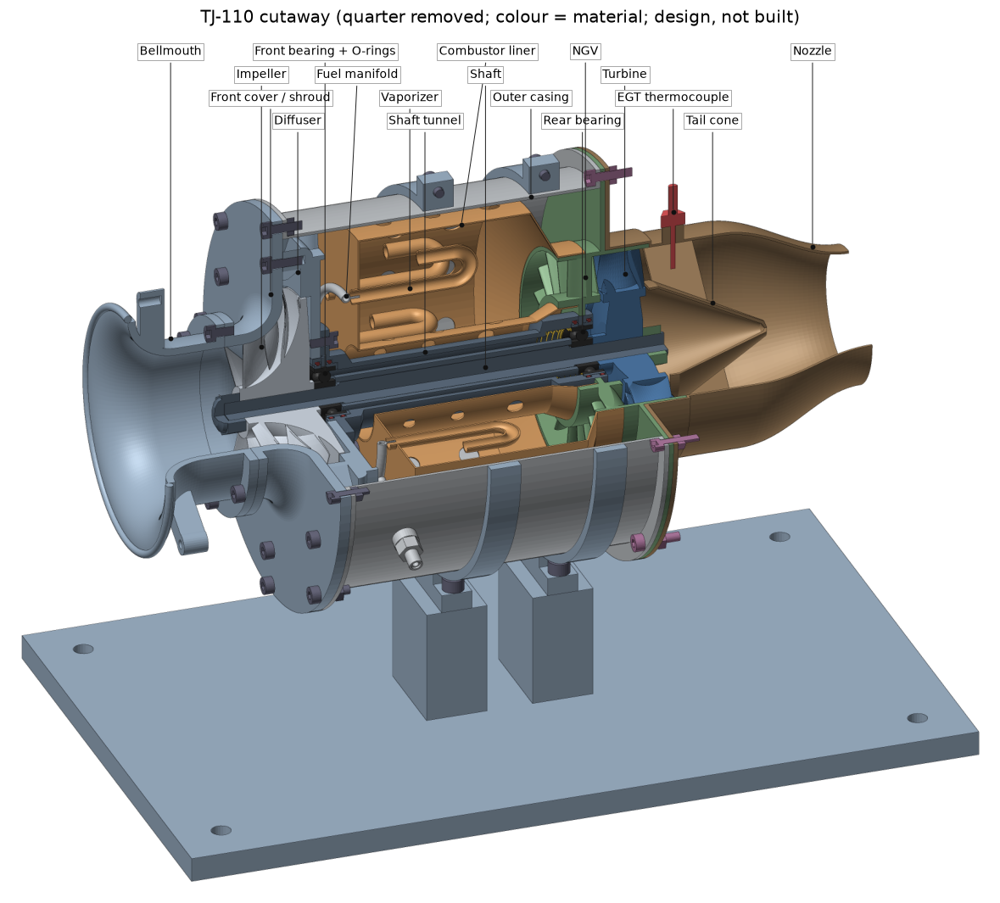

## Summary

### How it works
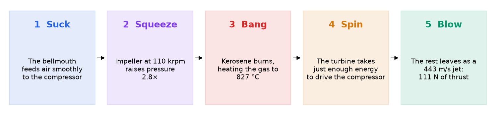

### Design point: sea level, 15 °C, standing still

| | |
|---|---|
| **Thrust** | **111 N** (≈ 11 kgf); 90 % range for build scatter 100–121 N |
| Fuel | **0.37 L/min** Jet A-1 or K-1 kerosene (TSFC 44.7 g/kN·s) |
| Air flow / pressure ratio / speed | 0.25 kg/s / 2.8 / 110 000 rpm |
| Turbine inlet / exhaust gas temperature | 827 °C / 715 °C |
| Jet | 443 m/s through a Ø42.9 mm nozzle |
| Size and mass | Ø119 mm casing (Ø130 flanges), 239 mm long, ≈ 1.96 kg |
| Compressor | Ø72.6 mm Al 2618 impeller, 7 + 7 blades, 30° backsweep, 418 m/s tip, η 0.76 |
| Turbine | Ø69.1 mm cast IN713C wheel, 27 blades, η 0.80 |
| Combustor | Annular 310-stainless liner, 75 mm long, 8 vaporizer tubes |
| Bearings | Two 608 hybrid ceramic bearings in O-ring dampers |

### What the simulations found
1. **The compressor wheel limits the pressure ratio.** Above PR ≈ 2.8 an aluminum 2618 impeller's safety factor drops
   below 1.2. More pressure (and better fuel economy) needs titanium. ([B2](charts/B2_pr_tit_maps.png), [E5](charts/E5_impeller_materials.png))
2. **Shaft speed sets the size, not the stress.** The tip speed (418 m/s) is fixed by the work needed. Faster shafts just
   make a smaller wheel. Bearings set the upper limit: 8 mm × 110 krpm needs hybrid ceramic bearings. ([C1](charts/C1_shaft_speed.png), [H5](charts/H5_bearing_DN.png))
3. **Soft-mount the bearings.** With hard-mounted bearings, two critical speeds (53 and 92 krpm) sit right in the operating
   range. O-ring mounts move them to 23 and 36 krpm, below idle. Shaft bending stays at 180 krpm. ([H1](charts/H1_campbell.png), [H2](charts/H2_bearing_stiffness.png))
4. **The builder's skill matters most:** compressor quality, combustor pressure loss and turbine tip clearance are each
   worth about ±5 N. Every 0.1 mm of turbine clearance costs ~1.5 N. ([I1](charts/I1_tornado.png), [C3](charts/C3_tip_clearance.png))
5. **Hot starts, not steady creep, limit turbine life.** At 827 °C TIT the IN713C blades have a huge creep margin, but at
   1030 °C life drops to ~50 h. ([E4](charts/E4_turbine_creep_life.png))
6. **Thrust goes as speed cubed and EGT is U-shaped:** hottest at full power and near idle, coolest near 75–80 krpm. ([G1](charts/G1_throttle_curve.png))
7. **The nozzle is the tuning knob:** 2 mm smaller ≈ +6 N and +135 °C EGT. ([G3](charts/G3_nozzle_area.png))
8. **Weather matters:** −30 °C gives +31 % thrust, +35 °C gives −11 %, Calgary's altitude −8 %. ([G2](charts/G2_ambient_effects.png))
9. **The design point is near-optimal:** the highest-thrust design in a 660-point search that passes all six limits. ([I3](charts/I3_design_space.png))

### What matters most

| Factor | Best choice | Confidence |
|---|---|---|
| Pressure ratio | 2.8 with an Al 2618 wheel (3.2+ needs titanium) | High trend, medium value |
| Turbine inlet temperature | 1100 K (827 °C); EGT limit 750 °C | Medium |
| Shaft speed | 110 krpm (sets Ø119 mm; bearing DN limit) | High |
| Impeller | 30° backsweep, 7 + 7 blades, 0.3 mm clearance or less | Medium |
| Turbine | ψ = 1.3, φ = 0.65; clearance as small as start-up rubs allow | Medium |
| Bearings | Hybrid ceramic 608s, O-ring mounted, span ≤ 95 mm | Medium–high |
| Materials | 2618 / 17-4PH / 310 SS / IN625 / cast IN713C / 321 SS | High (ranking) |
| Fuel | Kerosene + ~5 % turbine oil; propane start | High |

All 16 research questions are answered in **[docs/recommendations.md](docs/recommendations.md)**.

## CAD and build package

| Assembled section (by material) | Exploded view | All parts laid out |
|---|---|---|
| 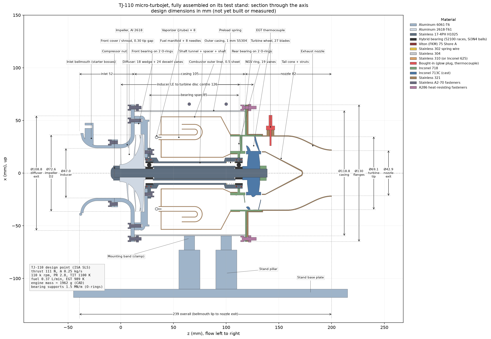 | 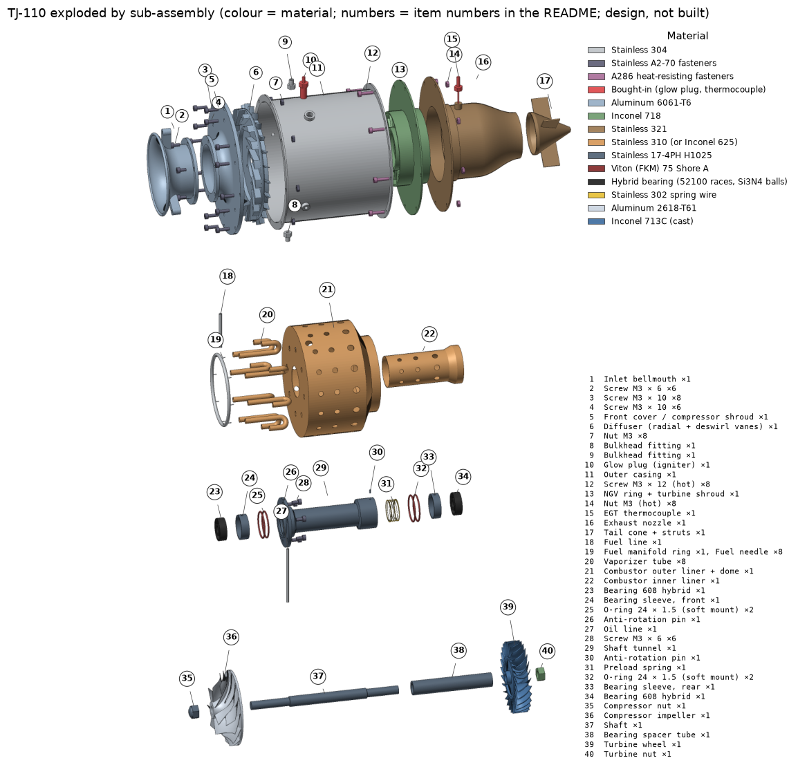 | 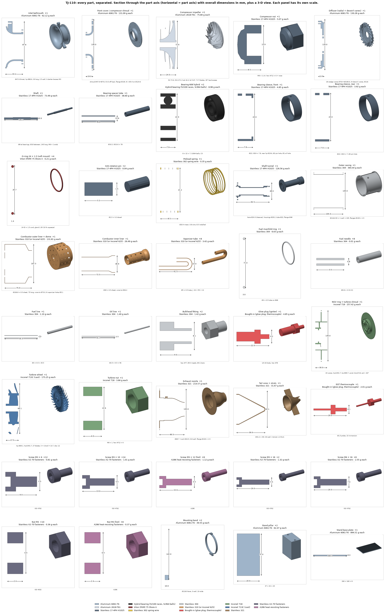 |

Every part is a watertight STL in [`cad/stl/`](cad/stl/). There are interactive 3-D viewers for the assembly
([`cad/viewer_TJ110.html`](cad/viewer_TJ110.html)) and the exploded engine ([`prototypes/TJ110_viewer_exploded.html`](prototypes/TJ110_viewer_exploded.html)).
40 unique parts (117 placed), engine mass ≈ 1.96 kg, 239 mm long. No interferences; impeller and turbine tip
clearances 0.30 mm cold ([`cad/interference_TJ110.txt`](cad/interference_TJ110.txt)). The build package, with parts and
materials, manufacturing route per part, tolerances and fits, balancing, a 16-step assembly sequence keyed to the exploded
view, a cost estimate in CAD and blank as-built and first-run sheets, is in **[prototypes/README.md](prototypes/README.md)**.
Model details: [cad/README.md](cad/README.md).

| Cost (CAD, indicative) | Low | High |
|---|---|---|
| Engine parts | $3,235 | $11,410 |
| ECU and instrumentation | $1,200 | $4,460 |
| Test stand and safety | $600 | $2,010 |
| **Total** | **$5,035** | **$17,880** |

## Key charts

| | |
|---|---|
| 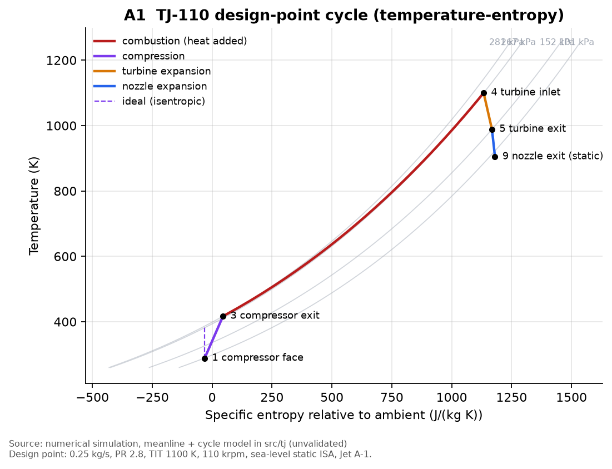 **The cycle (T–s)** | 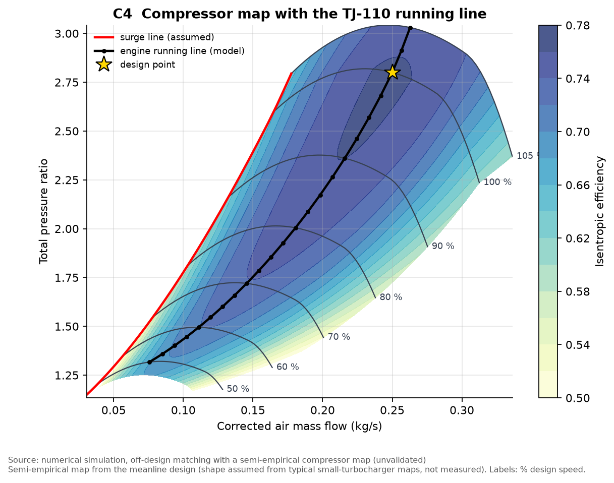 **Compressor map + running line** |
| 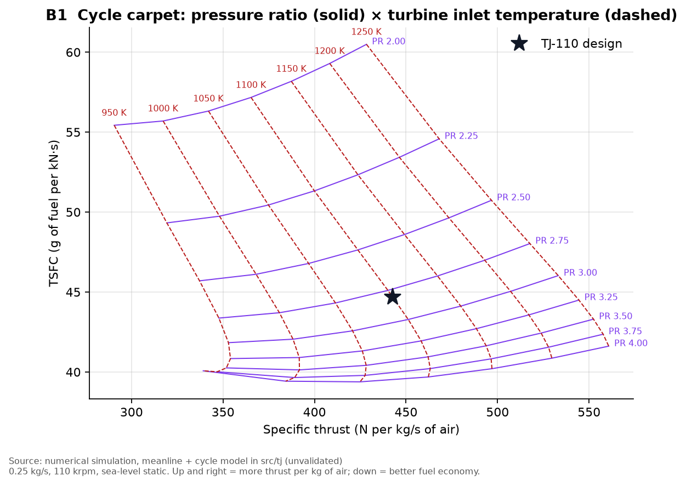 **Pressure ratio × turbine temperature** | 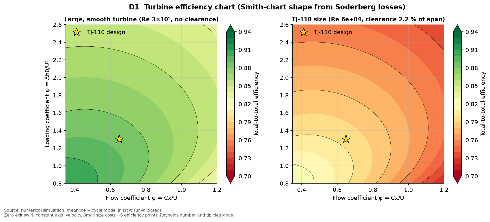 **Turbine efficiency chart** |
| 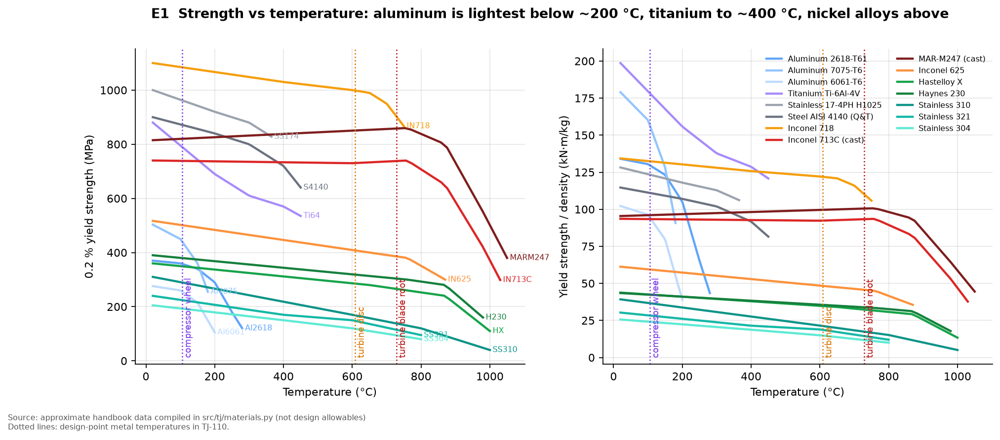 **Materials vs temperature** | 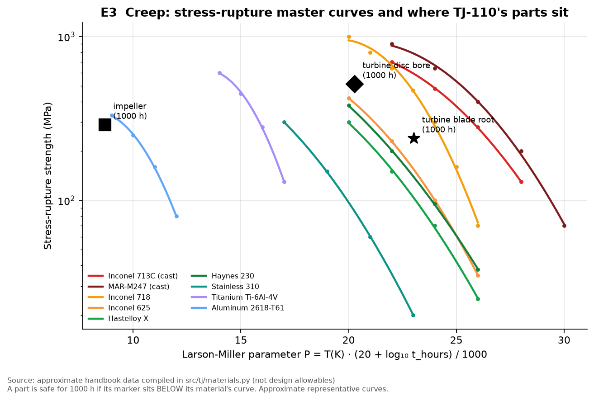 **Creep (Larson–Miller)** |
| 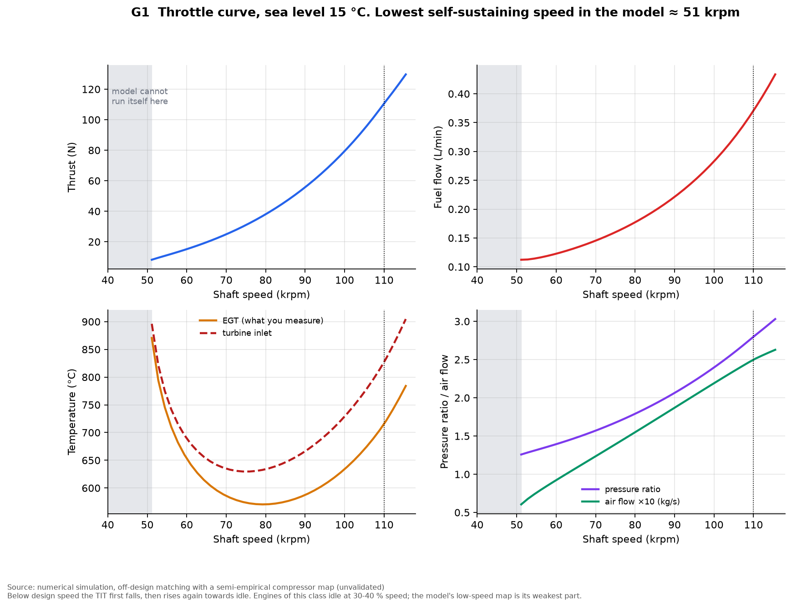 **Throttle curve** | 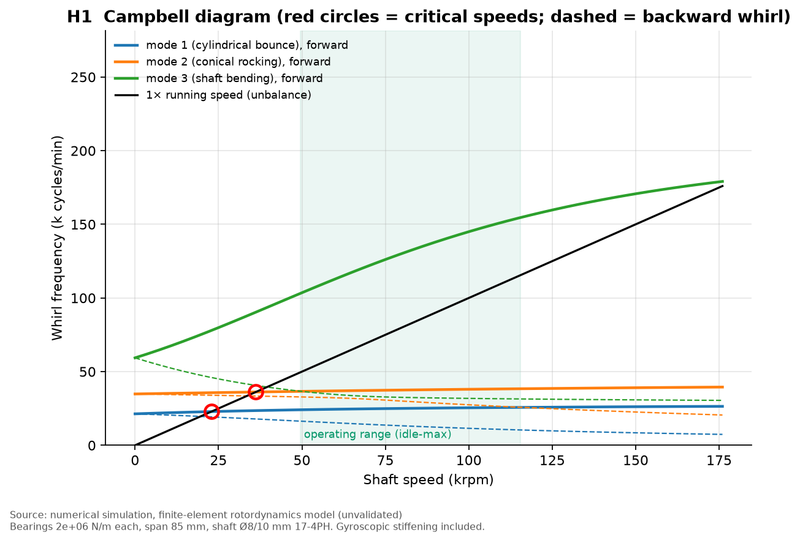 **Campbell diagram** |
| 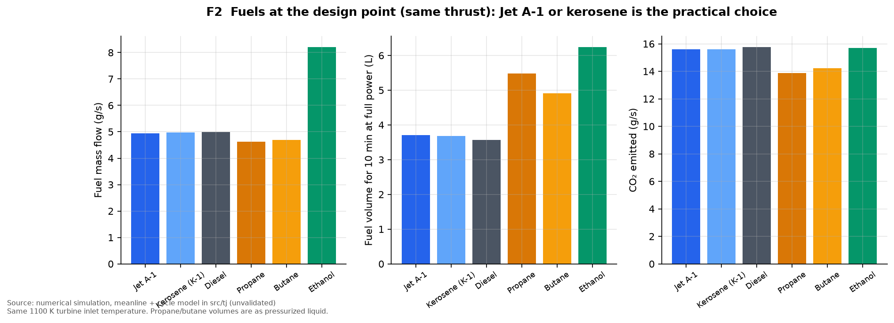 **Fuels** | 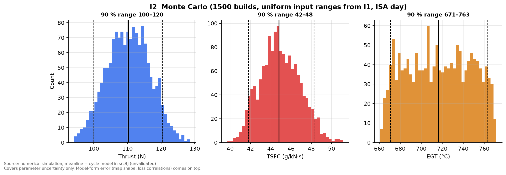 **Uncertainty** |

There are 42 charts in [`charts/`](charts/), as PNG and SVG. Every chart's footer states where its numbers come from.

## How the models work

All models are in [`src/tj/`](src/tj/):

- **Gas properties:** semi-perfect air and combustion products (JANAF-fitted cp(T)), plus the combustion energy balance.
- **Compressor meanline:** sizes the inducer for minimum relative Mach number, finds the tip speed from Euler work with
  Wiesner slip, and computes efficiency from specific speed. It then applies penalties for Reynolds number, tip clearance
  and build quality, and generates a semi-empirical map.
- **Turbine meanline:** velocity triangles, Soderberg losses with aspect-ratio, Reynolds and clearance corrections, and
  blade and disc stresses.
- **Cycle:** the design point is iterated until compressor and turbine efficiencies agree with their own meanline models.
- **Off-design matching:** compressor map, Stodola turbine and fixed nozzle area, solved for the running line.
- **Combustor sizing:** residence time, loading, air split and hole area.
- **Materials:** strength vs temperature and Larson–Miller creep for 15 alloys.
- **Rotordynamics:** finite elements with gyroscopic effects.

Equations: [physics.md](docs/physics.md). Assumptions, numerics, verification: [methodology.md](docs/methodology.md).

## Documents

| Read | For |
|---|---|
| [Project report (PDF)](docs/report/Turbojet_Engine_Type_TJ110_report.pdf) | The whole project in one document |
| [recommendations.md](docs/recommendations.md) | Answers to the research questions, build options, what to test first |
| [cycle](docs/results/cycle.md) · [compressor](docs/results/compressor.md) · [turbine](docs/results/turbine.md) · [combustor](docs/results/combustor.md) | Component results |
| [materials](docs/results/materials.md) | Strength, creep, thermal expansion, part-by-part selection |
| [off-design](docs/results/offdesign.md) · [rotordynamics](docs/results/rotordynamics.md) · [sensitivity](docs/results/sensitivity.md) | Throttle, weather, critical speeds, uncertainty |
| [physics.md](docs/physics.md) · [methodology.md](docs/methodology.md) | Equations, assumptions, verification |
| [literature_review.md](docs/literature_review.md) | 40 sources (34 DOIs checked against Crossref) |
| [prototypes/README.md](prototypes/README.md) · [cad/README.md](cad/README.md) | Build package (assembly, balancing, cost) and 3-D models |
| [experiments/test_plan.md](experiments/test_plan.md) | Instruments, test sequence, analysis script |
| [safety.md](docs/safety.md) | **Read before building or running anything** |

## Repository layout

| Path | Contents |
|---|---|
| `src/tj/` | Model code |
| `simulations/` | One script per study (phases A–I), verification, diagrams |
| `cad/`, `prototypes/` | 3-D models, viewers, drawings, exploded views, parts list, cost estimate |
| `data/`, `charts/`, `diagrams/` | Generated results and figures |
| `docs/`, `experiments/`, `references/` | Write-ups, test plan, bibliography |
| `tests/` | 18 automated verification tests (run on every push) |

## Reproduce

```bash
python3 -m venv .venv && .venv/bin/pip install -r requirements.txt   # see docs/environment.md if pip is missing
.venv/bin/python -m pytest
for s in phase_a_design_point phase_b_cycle phase_c_compressor phase_d_turbine phase_e_materials \
         phase_f_combustor phase_g_offdesign phase_h_rotordynamics phase_i_sensitivity verification diagrams; do
  .venv/bin/python simulations/$s.py
done
.venv/bin/python cad/build.py
.venv/bin/python prototypes/build_drawings.py
.venv/bin/python docs/report/build_report.py
```
Run `phase_a_design_point.py` first, because the CAD and drawings read `data/design_point.json`. The studies take a few
minutes on an 8-core CPU. No GPU is needed.

## Limitations
- **Nothing is validated against measurements of this engine.**
- Losses come from published correlations calibrated on larger machines, plus assumed small-size and build-quality penalties. There is no CFD.
- The low-speed compressor map is assumed. The model's lowest self-sustaining speed (51 krpm) is probably pessimistic.
- Material data are approximate handbook trends, not certified design allowables.
- The study has no start-up (transient) model, no heat-transfer model and no vibration-amplitude model.

## Author and credits
- **Author:** [roosterbrown14](https://github.com/roosterbrown14). Project concept and design direction.
  Design log: [docs/design_log.md](docs/design_log.md).
- **AI assistance:** the modelling code, analysis, CAD and documentation were developed with the help of
  Claude (Anthropic), an AI assistant.
- **Licence:** [MIT](LICENSE).

## Key references
Saravanamuttoo et al., *Gas Turbine Theory* (2017) · Dixon & Hall, *Fluid Mechanics and Thermodynamics of Turbomachinery* (2014) ·
Lefebvre & Ballal, *Gas Turbine Combustion* (2010, [doi](https://doi.org/10.1201/9781420086058)) · Wiesner 1967 (slip factor) ·
Smith 1965 (turbine efficiency) · Larson & Miller 1952 (creep) ·
van den Hout & Koullen 1996, a very small turbojet ([doi](https://doi.org/10.1115/96-gt-456)).
Full list: [references.bib](references/references.bib).
