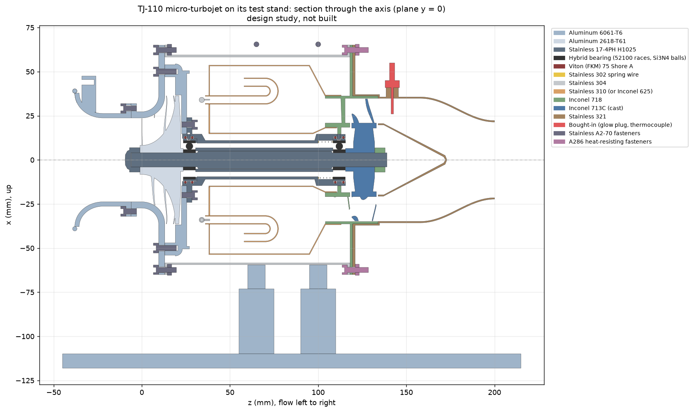
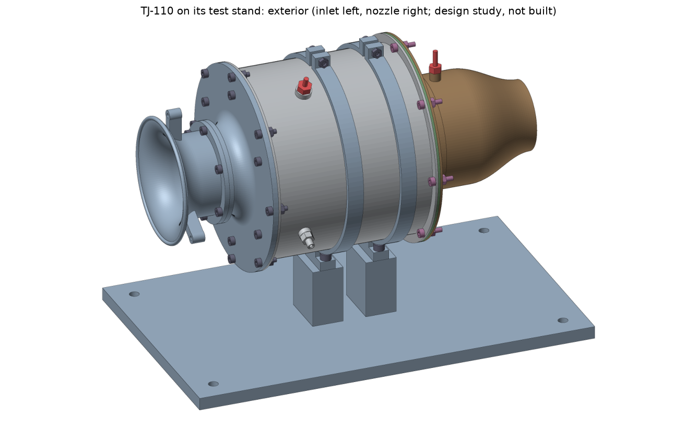

# TJ-110 3-D part models

**Design study: not machined, cast, assembled or run.** Every part is generated parametrically by
`cad/build.py` (manifold3d + trimesh). All dimensions are in millimetres. The gas-path sizes come from
the cycle and aero model in [`data/design_point.json`](../data/design_point.json) (SI, metres), so
re-running the model and then `cad/build.py` resizes the engine. TJ-110 is an original, generic
single-spool layout: bellmouth → centrifugal compressor → vaned radial diffuser with axial deswirl →
annular vaporizer combustor → NGV → axial turbine → convergent nozzle with tail cone. It is not a copy
of any commercial or kit engine.

| Output | What it is |
|---|---|
| `stl/*.stl` | One watertight STL per unique part (40 parts), each at its own origin |
| `assembly_TJ110.stl` | Full assembly on the test stand (117 placed parts, decimated to < 5 MB for viewing) |
| `viewer_TJ110.html` | Interactive 3-D viewer. Open in a browser and click legend entries to hide parts (the casing, nozzle and front cover are semi-transparent). Needs internet for the Plotly script. |
| `bom_TJ110.csv` | Bill of materials: quantity, material, process, envelope and mass from the mesh volume × density |
| `interference_TJ110.txt` | Pairwise overlap check of every placed part, plus rotor-to-stator running clearances |
| `../diagrams/cad_TJ110_section.png`, `cad_TJ110_exterior.png` | Section through the axis, and a shaded exterior render |





Coordinates: the engine axis is +z (flow direction), with z = 0 at the impeller inducer leading edge.
"Up" is +x, and the test stand sits on the −x side.

## Where the dimensions come from

| CAD dimension | Value (mm) | Source in `design_point.json` |
|---|---|---|
| Impeller tip Ø D2 / exit blade height b2 | 72.6 / 5.67 | `compressor.r2`, `compressor.b2` |
| Inducer tip Ø / hub Ø | 47.0 / 16.4 | `compressor.r1t`, `compressor.r1h` (hub/tip 0.35) |
| Blades / backsweep / inducer tip angle | 7 + 7 / 30° / 60° | `spec.Z`, `spec.beta2b`, `compressor.beta1t` |
| Shroud and turbine tip clearance | 0.30 | `spec.clear_c`, `spec.clear_t` |
| Diffuser outer Ø | 108.8 (1.5 × D2) | `compressor.r3` |
| Casing ID / wall | 116.8 / 1.0 | `geometry.r_case_in`, `spec.casing_wall` |
| Liner inner / outer Ø, length | 30 / 106.8, 75 | `geometry.liner_in`, `liner_out`, `liner_len` |
| Liner hole area | 1590 mm², 45 % in dilution | `combustor.A_holes`, `combustor.split_dilution` |
| Shaft Ø at bearings / between, span | 8 / 10, 85 | `spec.shaft_d`, `shaft_d_mid`, `bearing_span` |
| Turbine tip / hub Ø, blade height = axial chord | 69.1 / 41.7, 13.7 | `turbine.rt`, `rh`, `h`, `chord` |
| Rotor / NGV blade numbers | 27 / 19 | `spec.Zr`, `spec.Zn` |
| NGV exit angle and turbine blade angles | free vortex from the mean-line triangles (NGV ~63°, rotor 25° → −57° at mean) | `turbine.C2`, `alpha2`, `U`, `Cx`, `psi` |
| Nozzle exit Ø | 42.9 | `geometry.D_nozzle` |
| Bearing support stiffness (target) | 1.5 MN/m per bearing | `spec.k_bearing` |

Design choices made in `build.py` (not in the model): the axial layout (front bearing 13 mm behind the
impeller centroid, turbine disc 14 mm behind the rear bearing, combustor dome at z = 38), wall
thicknesses, flanges (1.5 mm, Ø130, 8 × M3 on Ø124.6), the 18 wedge vanes (the brief said about 17:
18 lets the six front-cover screws land on every third vane), 24 deswirl vanes, vaporizer geometry
and all fasteners.

## Parts

| Part (`stl/<name>.stl`) | Qty | Material | Mass each (g) | Role |
|---|---|---|---|---|
| `bellmouth` | 1 | Al 6061-T6 | 62 | Elliptical inlet lip; 3 M3 bosses for a starter bracket |
| `front_cover` | 1 | Al 6061-T6 | 131 | Compressor shroud (0.30 mm off the blade tips), diffuser front wall, front flange |
| `impeller` | 1 | Al 2618-T61 | 75.8 | 7 main + 7 splitter blades about 1 mm thick, 30° backsweep |
| `compressor_nut` | 1 | 17-4PH | 5.1 | M8 × 1 with a nose for the starter cone |
| `diffuser` | 1 | Al 6061-T6 | 130 | 18 wedge vanes to Ø108.8, rounded 90° turn, 24 axial deswirl vanes |
| `shaft` | 1 | 17-4PH H1025 | 73.5 | Ø8 at the bearings, Ø10 between |
| `spacer_tube` | 1 | 17-4PH | 38.6 | Clamps the two inner races (stack: nut, impeller, bearing, spacer, bearing, turbine, nut) |
| `bearing_608` | 2 | 52100 races + Si3N4 balls | 9.0 | 8 × 22 × 7 hybrid ceramic, oil-mist lubricated |
| `bearing_sleeve_front` / `_rear` | 1 / 1 | 17-4PH | 4.9 / 3.9 | **Soft mount** cartridges Ø22/Ø24; the front one has a lip that locates the outer race |
| `oring_24x1.5` | 4 | Viton FKM 75 Shore A | 0.2 | Two per sleeve, in tunnel-bore grooves; modelled at 10 % installed squeeze |
| `anti_rotation_pin` | 2 | 17-4PH dowel | 0.04 | Stops the sleeves turning; loose in a Ø2 sleeve hole so it adds no radial stiffness |
| `preload_spring` | 1 | 302 spring wire | 0.4 | Pushes the rear outer race rearward |
| `shaft_tunnel` | 1 | 17-4PH | 127 | Bearing housings, front flange bolted to the diffuser, rear spigot sliding in the NGV hub web (free thermal growth); oil drilling to the front bearing |
| `outer_casing` | 1 | SS304 1 mm sheet | 364 | Welded flanges and bosses for the fuel and oil fittings and the glow plug |
| `liner_outer` | 1 | SS310 0.5 mm (or IN625) | 132 | Outer wall + dome, 8 vaporizer holes, primary/secondary/dilution holes, glow-plug hole |
| `liner_inner` | 1 | SS310 0.5 mm | 26.5 | Inner wall with three rows of holes |
| `vaporizer` | 8 | SS310 Ø5 × 0.5 tube | 3.4 | J-tube: 34 mm leg, R5 bend, 12 mm return leg |
| `fuel_manifold`, `fuel_needle`, `fuel_line`, `oil_line`, `line_fitting` | 1, 8, 1, 1, 2 | SS304 | — | Fuel ring with 8 needles into the vaporizer inlets; feed and oil lines through casing bulkhead fittings |
| `glow_plug`, `egt_thermocouple` | 1, 1 | bought-in | — | Igniter; K-type Ø1.5 EGT probe in a nozzle boss |
| `ngv_ring` | 1 | Inconel 718 | 257 | 19 twisted vanes, turbine shroud, rear flange, hub web |
| `turbine_wheel` | 1 | Inconel 713C (cast) | 175 | 27 twisted, cambered, unshrouded blades on a 12 mm disc |
| `turbine_nut` | 1 | Inconel 718 | 3.7 | M8 × 1 |
| `nozzle` | 1 | SS321 0.8 mm | 215 | Convergent to Ø42.9, EGT boss |
| `tail_cone` | 1 | SS321 0.8 mm | 31.7 | Cone + 4 struts welded to the nozzle wall |
| `screw_M3x6`, `screw_M3x10`, `nut_M3` | 12, 14, 10 | A2-70 | — | Bellmouth, tunnel flange, diffuser vanes, front flange, band clamps |
| `screw_M3x12_A286`, `nut_M3_A286` | 8, 8 | A286 | — | Hot rear flange (casing / NGV / nozzle) |
| `mounting_band`, `stand_pillar`, `stand_base`, `screw_M3x16`, `screw_M4x16` | 2, 2, 1, 2, 8 | Al 6061 / A2 | — | Test stand |

**Engine mass about 1.96 kg** (without the stand, 1.12 kg more). The rotating assembly is 372 g
without the bearings: impeller 75.8 g and turbine 175 g, against 75.3 g and 163 g assumed in the
rotordynamics model. The heaviest items are the 1 mm stainless casing (364 g), the NGV ring with its
flange (257 g) and the nozzle (215 g). This is a deliberately robust first build, and those three
parts are where weight would come out in a second iteration.

## Checks ([`interference_TJ110.txt`](interference_TJ110.txt))

1. **Overlaps.** Boolean intersection of every pair of the 117 placed parts whose bounding boxes
   overlap: **no interferences** (tolerance 0.5 mm³). Threads are not modelled. Tapped holes are drawn at
   the M3 major diameter and screws 0.05 mm under it, so a threaded joint does not count as a clash.
2. **Running clearances.** Each rotating part is swept about the axis and compared with every
   stationary part in the meridional (r, z) plane. This is exact for axisymmetric stators and
   conservative for vaned ones. The values are cold and static: thermal and centrifugal growth are not
   included.

| Check | Cold gap (mm) | Requirement |
|---|---|---|
| Impeller blade tip to shroud | 0.30 | ≥ 0.25: PASS |
| Turbine blade tip to shroud | 0.29 | ≥ 0.25: PASS (0.30 design; chordal facet of the mesh) |
| NGV trailing edge to turbine blade leading edge (axial) | 1.00 | ≥ 0.8: PASS |
| Impeller exit to diffuser vane leading edge (radial) | 2.90 | ≥ 1.5: PASS |
| Impeller back face to diffuser / tunnel | 0.50 / 1.00 | ≥ 0.4: PASS |
| Turbine disc to tail cone | 1.00 | ≥ 0.5: PASS |
| Soft-mount radial travel (sleeve in tunnel bore) | 0.15 | snubber gap: limits the orbit before metal contact |

## Soft bearing mounts

The rotordynamics study (`spec.k_bearing` = 1.5 MN/m) puts the two rigid-body modes at about
**22 900 and 36 200 rpm, below idle**, and the first bending mode at about 180 000 rpm (1.6 × the
110 000 rpm design speed). Each 608 outer race sits in a thin 17-4PH sleeve (Ø22/Ø24) carried by two
Viton 24 × 1.5 O-rings in grooves in the tunnel bore (groove Ø26.7, 1.9 wide: 1.35 mm gland, 10 %
squeeze). The bore over the sleeve is Ø24.3, which leaves 0.15 mm radial travel. Two O-rings of 75
Shore A FKM at this squeeze should give roughly 1–2 MN/m per bearing. The stiffness has to be checked
on the bench (a static push test on a sleeve), and the squeeze adjusted with the groove diameter. A
Ø1.5 dowel stops each sleeve rotating without touching it radially. The front sleeve's rear lip takes
the axial load from the spring preload.

## Limitations
- Blade shapes are reasonable engineering approximations (impeller blade angle blended linearly from
  inducer to exit; free-vortex turbine and NGV sections with parabolic thickness). They are not
  CFD-designed or stress-checked in 3-D.
- Threads, weld beads, fillets at blade roots and the starter bracket are not modelled. The O-rings are
  shown at their installed squeeze.
- The meshes are faceted: 128 segments per revolution, so a 0.01–0.02 mm chordal error on the
  clearances.
- Mass uses nominal densities. The bearing and the bought-in items use effective densities.

## Rebuild / change a parameter
```bash
.venv/bin/python cad/build.py               # ~45 s: STLs, BOM, checks, viewer, section + exterior PNGs
.venv/bin/python prototypes/build_drawings.py   # ~2 min: drawing package (reads cad/bom_TJ110.csv)
```
Change the model and regenerate `data/design_point.json` to resize the gas path. Layout choices are in
the `Cfg` class at the top of `build.py`.
