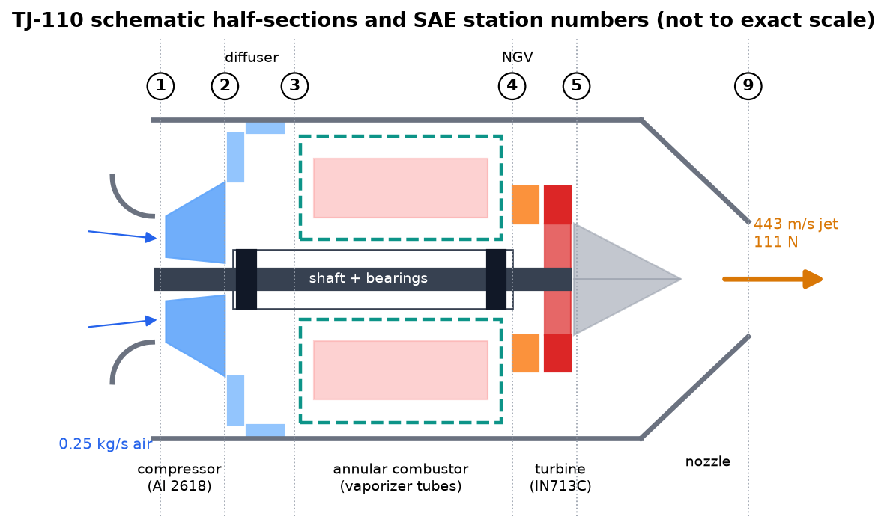

# Physics and governing equations

This page explains how a small turbojet works and gives the equations the models in `src/tj/` solve.
Stations follow the SAE ARP755 style used in most textbooks (Saravanamuttoo et al. 2017; Walsh & Fletcher 2004):

| Station | Where |
|---|---|
| 0 | Ambient air |
| 1 | Bellmouth exit / compressor face |
| 2 | Impeller tip |
| 3 | Diffuser exit = combustor inlet |
| 4 | Turbine inlet (nozzle guide vanes, NGV) |
| 5 | Turbine exit |
| 9 | Nozzle exit |



## 1. The idea in one paragraph

A turbojet is a heat engine whose "piston" is a stream of air. The **compressor** raises the air's
pressure. **Burning fuel** at nearly constant pressure raises its temperature (and so its volume).
The **turbine** takes just enough energy out of the hot gas to drive the compressor through the shaft.
Everything left over leaves the **nozzle** as a fast jet. Thrust is the momentum the engine adds to the air:

```
F = m9 V9 − m0 V0 + A9 (p9 − p0)
```

At a standstill (V0 = 0) and with an unchoked nozzle (p9 = p0), thrust is simply mass flow × jet speed.
TJ-110 moves 0.25 kg/s at 443 m/s: about 111 N.

## 2. Gas properties

Air and combustion products are treated as **semi-perfect gases**: ideal-gas law, but cp depends on
temperature and on the fuel–air ratio. Each species (N₂, O₂, Ar, CO₂, H₂O) has cp(T) from a quartic fit
to JANAF tables; mixtures are mole-weighted. Enthalpy `h(T)` and the entropy function `φ(T) = ∫cp/T dT`
are integrated analytically. An isentropic change of pressure ratio π satisfies

```
φ(T2) − φ(T1) = R ln π
```

Using cp(T) instead of a constant matters: hot gas (γ ≈ 1.32) gives up less work per unit pressure drop
than cold air (γ = 1.40), which costs ~8 % of cycle efficiency compared with the textbook constant-γ answer.

## 3. Component equations

### Compressor (centrifugal)
Isentropic work and actual work:
```
Δh0s = h(T03s) − h(T01),   Δh0 = Δh0s / ηc
```
Euler's turbomachinery equation, with slip and parasitic losses:
```
Δh0 = σ (1 − φ2 tan β2b) U2² (1 + k_par)
σ  = 1 − √cos β2b / Z^0.7            (Wiesner 1967)
```
U2 is the impeller tip speed, β2b the blade backsweep from radial, φ2 = Cr2/U2 the exit flow coefficient,
Z the number of blades at the exit. This equation decides the **tip speed**: TJ-110 needs 418 m/s.
Shaft speed then only sets the diameter (D2 = 2U2/ω).

Efficiency comes from the specific speed `Ns = ω√(ṁ/ρ01)/Δh0s^0.75` (peak near 0.75, Rodgers / Balje
trend), corrected for size (Reynolds number, Wiesner/Pampreen form `(1−η) ∝ Re^−0.1`), tip clearance
(Δη = 0.35 ε/b2, Senoo-type) and hobby-build quality.

### Combustor
Energy balance on 1 kg of air (sensible enthalpies from 298 K, fuel at 298 K):
```
(1 + f) hp(T04) − ha(T03) = ηb f LHV
p04 = p03 (1 − Δp/p)
```
The equivalence ratio is φ = f / f_stoich (f_stoich = 0.068 for kerosene). The engine runs very lean
overall (φ ≈ 0.30), so most air is used to cool the gas down to what the turbine can survive.

### Turbine (axial)
The turbine must deliver the compressor power (mechanical efficiency ηm):
```
ṁ4 (h04 − h05) ηm = ṁ Δh0,c
```
At the mean radius, with constant axial velocity and no exit swirl:
```
ψ = Δh0/U² (loading),   φ = Cx/U (flow coefficient),   R = 1 − ψ/2 (reaction)
tan α2 = ψ/φ,  tan β2 = (ψ − 1)/φ,  tan β3 = −1/φ
```
Losses: Soderberg's correlation `ζ = 0.04 [1 + 1.5 (ε/100)²]` (ε = blade deflection), corrected for aspect
ratio and Reynolds number (Dixon & Hall 2014), plus a tip-clearance penalty Δη = 2 ε/h.

### Nozzle (convergent)
Choked if `p05 / p0 > ((γ+1)/2)^(γ/(γ−1)) ≈ 1.85`. TJ-110's nozzle pressure ratio is 1.47, so it is
unchoked: the jet expands to ambient pressure and `V9 = Cv √(2 (h05 − h9))`.

## 4. Off-design (running the engine at other speeds)

The hardware is fixed, so at each shaft speed three conditions decide the operating point:

1. **Turbine flow capacity**, Stodola's ellipse law: `ṁ4 √T04 / p04 = K √(1 − (p05/p04)²)`
2. **Power balance**: turbine work × ηm = compressor work
3. **Nozzle flow**: the fixed exit area must pass ṁ4 at (T05, p05)

The compressor follows a semi-empirical map. The solution traces the **running line** on the compressor
map ([C4](../charts/C4_compressor_map.png)) and the throttle curve ([G1](../charts/G1_throttle_curve.png)).

## 5. Mechanical

**Rotating parts.** A spinning ring of material at tip speed U carries a hoop stress of about ρU².
That is why the impeller's stress depends on tip speed and density, not on rpm alone:
```
σ_impeller ≈ 0.6 ρ U2²                     (FE-typical factor for a backswept impeller with bore)
σ_blade root = K ρ ω² A_annulus / (2π)     (K = 0.6 for a tapered blade)
```
The turbine disc uses the exact elastic solution for a uniform rotating disc with a bore, loaded at the rim by
the blades (Timoshenko & Goodier). The burst margin uses Robinson's criterion:
`N_burst/N = √(0.85 UTS / σ_hoop,avg)`.

**Creep.** Hot metal under load slowly stretches and finally breaks. The Larson–Miller parameter
collapses temperature and time onto one curve per alloy (Larson & Miller 1952):
```
P = T[K] (20 + log10 t_hours)
```

**Rotordynamics.** The shaft, wheels and bearings form a spring–mass system. Euler–Bernoulli beam elements,
rigid discs (mass, diametral and polar inertia) and bearing springs give

```
(K − ω² M + ω Ω P) R = 0
```
with gyroscopic coupling P (polar inertias) at shaft speed Ω. A **critical speed** is where a forward-whirl
frequency equals Ω: there, any unbalance is amplified. Setting ω = Ω gives `K R = Ω² (M − P) R` directly.
For the Jeffcott rotor the critical speed is just √(k/m) (Jeffcott 1919; Vance et al. 2010).

## 6. What the models do not include

- No CFD. Losses come from correlations calibrated on larger machines, plus penalties for small size.
- No heat transfer between parts: metal temperatures are estimated from gas temperatures.
- No dissociation in flame temperature, so near-stoichiometric flames are overestimated.
- No transient (start-up, acceleration) model. Start-up is the hardest part of running a small turbojet.
- No vibration *amplitudes* (unbalance response): only frequencies and critical speeds.
