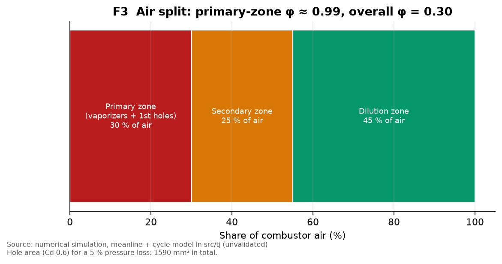
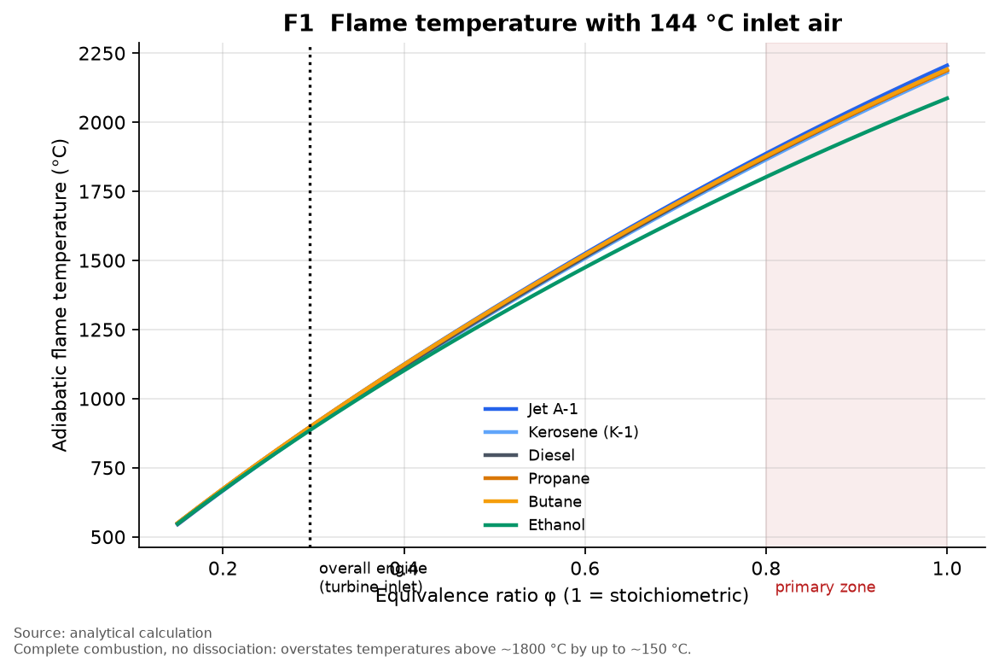
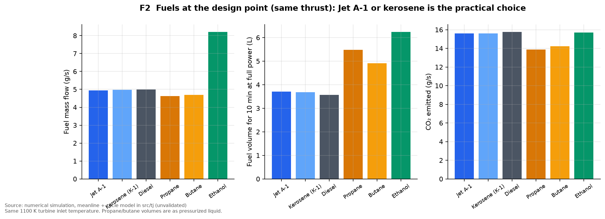
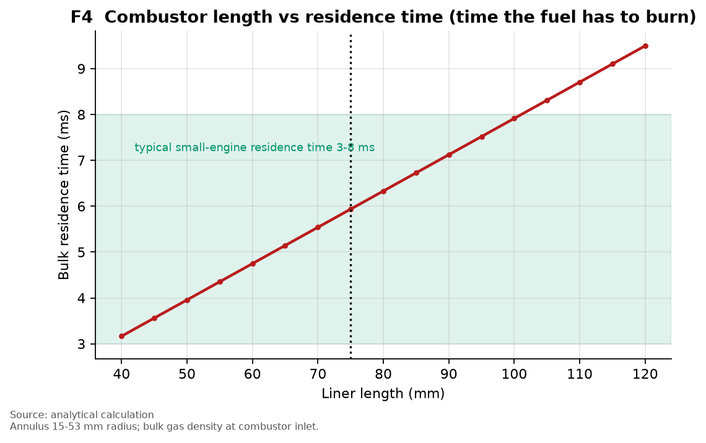
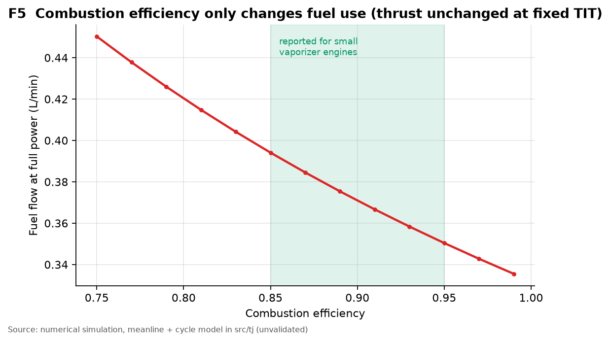

# Phase F: combustor and fuels

Script: `simulations/phase_f_combustor.py`. Data: `data/phase_f_*.csv`.

## 1. The TJ-110 combustor

| Quantity | Value |
|---|---|
| Type | Annular liner, 8 vaporizer tubes |
| Liner annulus | radius 15–53 mm, 75 mm long, 0.62 L |
| Bulk residence time | 5.9 ms (typical small engines: 3–8 ms) |
| Reference velocity | 12.6 m/s |
| Air split primary / secondary / dilution | 30 / 25 / 45 % |
| Primary-zone equivalence ratio | 0.99 (close to stoichiometric: stable flame) |
| Overall equivalence ratio | 0.30 |
| Total effective hole area for 5 % pressure loss | 1 590 mm² (Cd 0.6), ≈ 120 holes of Ø4.1 mm equivalent |

Combustion efficiency is an **input** (0.90). Small engines run at combustion loadings far beyond the
range of Lefebvre's large-engine correlations, so the correlation is used only for comparison
(see the [literature review](../literature_review.md)); 85–95 % is what small vaporizer engines report.

## 2. Flame temperature

Near stoichiometric the flame is around 2 200 °C; no metal survives that, which is why 70 % of the air enters
downstream to cool the gas to 827 °C. The model ignores dissociation, so it overstates the hottest flames.

## 3. Fuels

| Fuel | Fuel flow (L/min) | 10 min at full power (L) | Notes |
|---|---|---|---|
| **Jet A-1** | **0.37** | **3.7** | Standard; mix with ~5 % turbine oil for bearing lubrication |
| Kerosene (K-1) | 0.37 | 3.7 | Same performance; available at Canadian hardware stores |
| Diesel | 0.36 | 3.6 | Harder to vaporize, smokier, harder starts |
| Propane | 0.55 | 5.5 (as liquid) | Start gas only |
| Butane | 0.49 | 4.9 (as liquid) | Start gas |
| Ethanol | 0.62 | 6.2 | 1.7× the fuel by mass; no benefit |

All fuels give the same thrust at the same TIT. **Jet A-1 or K-1 kerosene, with propane for starting.**

## 4. Liner length

Residence time scales with liner length. 75 mm gives 5.9 ms, in the middle of the usual small-engine range.
A shorter liner shortens the shaft (good for rotordynamics) but risks flames reaching the NGVs.

## 5. Combustion efficiency

Going from 85 % to 95 % combustion efficiency saves ~10 % fuel (0.39 → 0.35 L/min) with no change in thrust.
Poor combustion shows up as unburnt fuel, smoke, and flames out of the nozzle.
