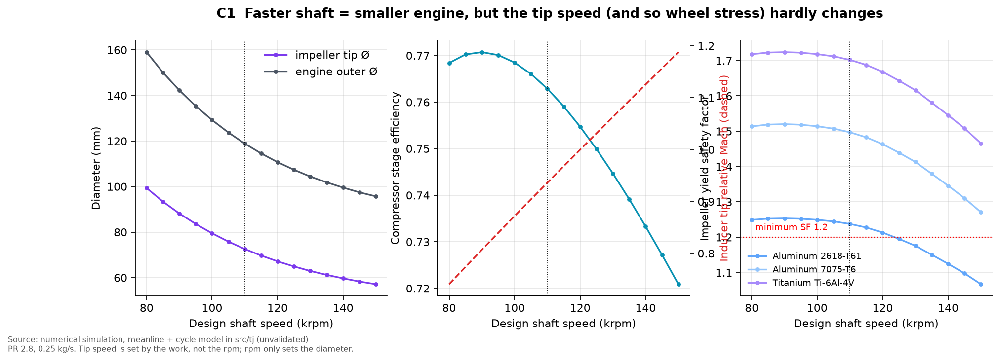
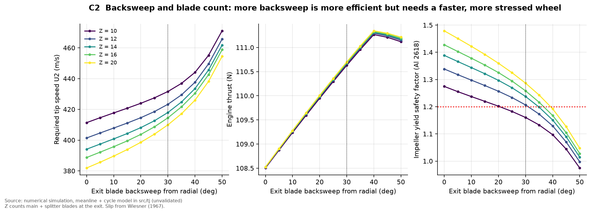
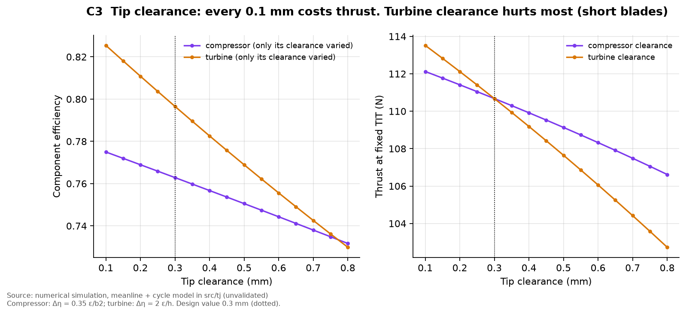
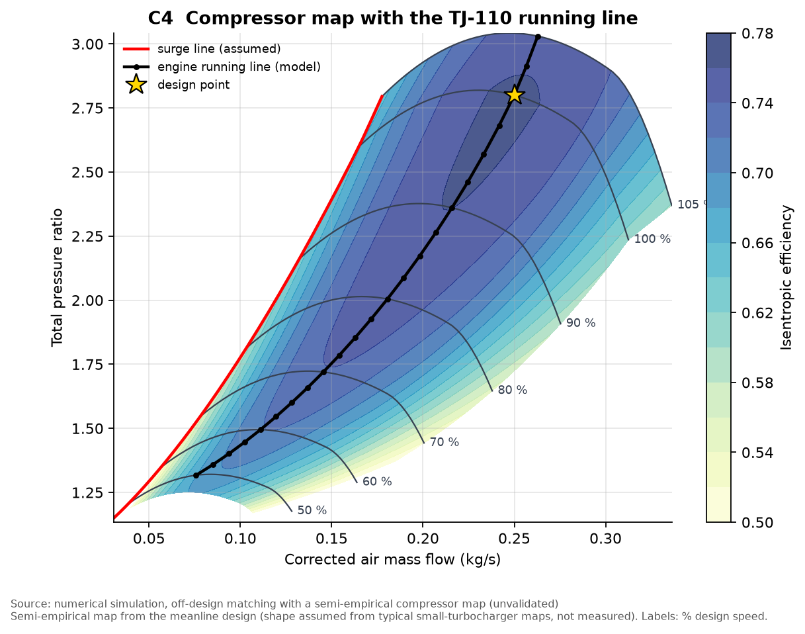

# Phase C: compressor

Script: `simulations/phase_c_compressor.py`. Data: `data/phase_c_*.csv`. [numerical simulation, unvalidated]

## 1. The TJ-110 impeller

| Quantity | Value |
|---|---|
| Tip diameter D2 | 72.6 mm |
| Inducer tip / hub diameter | 47.0 / 16.5 mm |
| Exit blade height b2 | 5.7 mm |
| Blades | 7 main + 7 splitter, 30° backsweep |
| Tip speed U2 | 418 m/s |
| Inducer tip relative Mach number | 0.94 (subsonic; < 1 keeps shock losses away) |
| Slip factor (Wiesner) | 0.85 |
| Stage efficiency | 0.763 (0.82 for a perfect wheel of this size, −1.9 pts clearance, −4 pts build quality) |
| Specific speed Ns | 0.94 (near the 0.6–0.9 optimum band) |
| Impeller exit absolute Mach | 0.84, flow angle 69° from radial (into vaned diffuser) |
| Vaned diffuser exit radius | 54.4 mm (1.5 × r2) |

## 2. Shaft speed sets size, not stress

The tip speed needed for PR 2.8 is about 418 m/s whatever the rpm. Faster shafts make a smaller wheel
(99 mm at 80 krpm, 57 mm at 150 krpm) and a slimmer engine, but the wheel stress barely changes, and the
efficiency falls slowly above ~100 krpm as the wheel gets smaller. Bearings set the practical upper limit
(DN, see [rotordynamics](rotordynamics.md)). **110 krpm** gives a 119 mm engine with 608-size bearings
inside their hybrid-ceramic DN limit.

## 3. Backsweep and blade count

| Backsweep | Tip speed | Efficiency | Safety factor (2618) | Thrust |
|---|---|---|---|---|
| 0° (radial) | 394 m/s | 0.746 | 1.39 | 108.5 N |
| 30° (chosen) | 418 m/s | 0.763 | 1.24 | 110.7 N |
| 45° | 446 m/s | 0.768 | 1.09 | 111.3 N |

Backsweep makes the wheel more efficient and widens its stable range, but it reduces the work per unit tip
speed, so the wheel must spin faster. **30° is the knee**: most of the efficiency gain with SF still above 1.2.
More blades reduce slip (14 → 20 blades: lower tip speed) but add blockage and make small wheels hard to
machine. 7 + 7 splitters is a practical choice for 5-axis milling.

## 4. Tip clearance

Every 0.1 mm of clearance costs about 0.7 N through the compressor and **1.5 N through the turbine**, whose
blades are short (13.7 mm). Get the turbine clearance right first.

## 5. Compressor map and running line

The design point sits on the efficiency ridge with a 51 % surge margin (flow-based). Down the running line,
the margin first grows, then shrinks near idle. The model engine stops being able to sustain itself near
51 krpm (46 %). The map shape is assumed from typical small turbocharger maps: **the running line near idle
is the least certain result in this study**.
