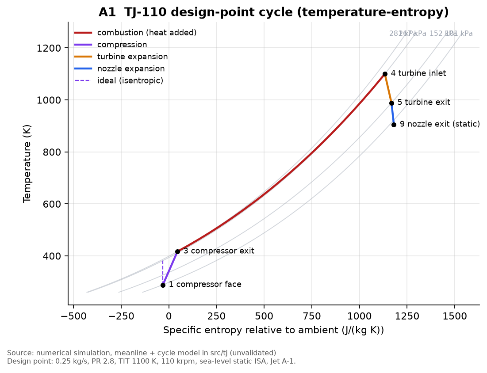
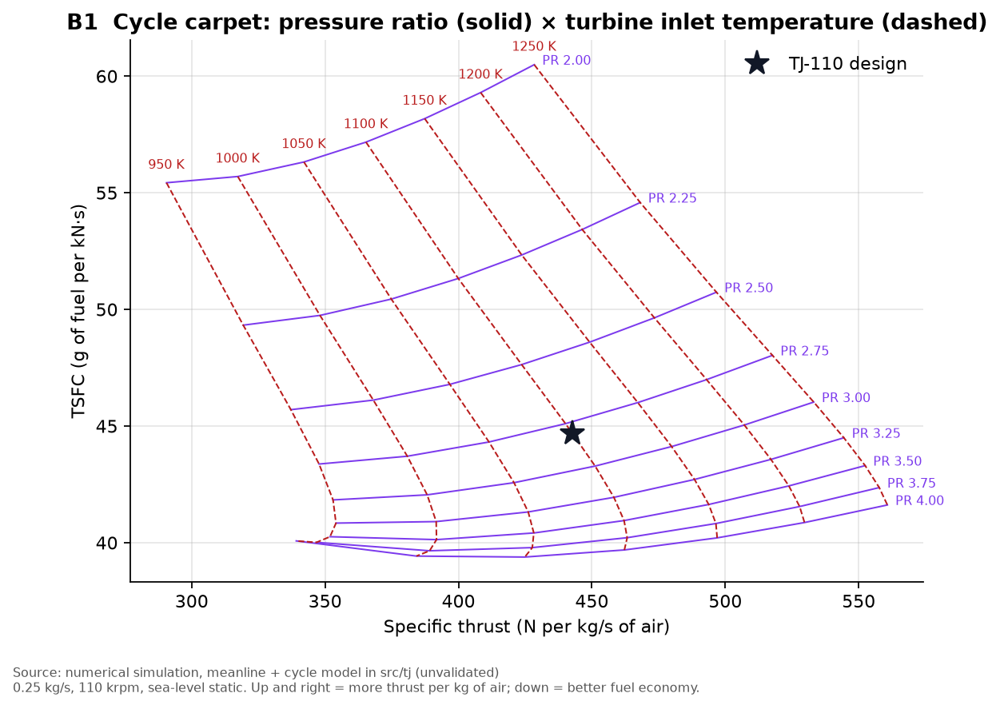
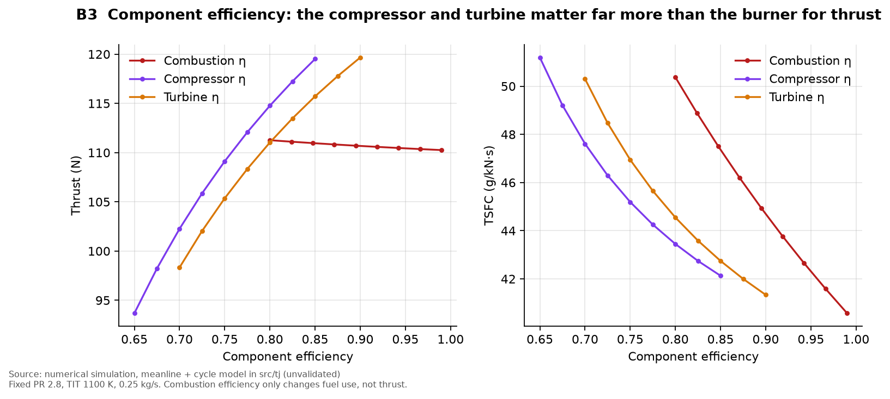
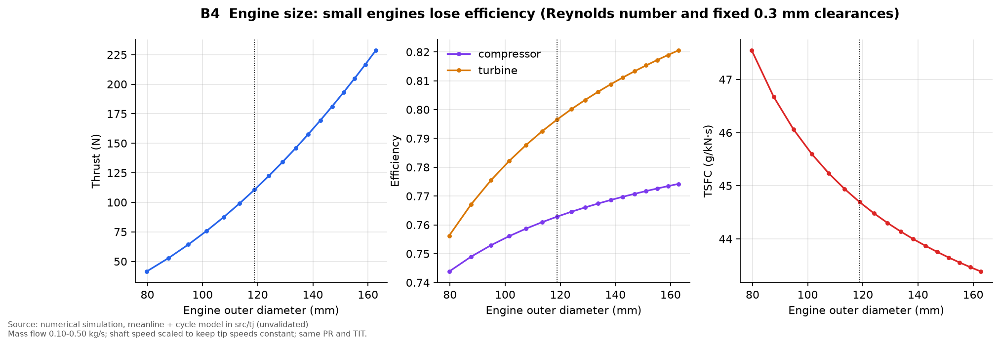

# Phases A–B: design point and cycle trades

Scripts: `simulations/phase_a_design_point.py`, `simulations/phase_b_cycle.py`.
Data: `data/design_point.json`, `data/phase_a_stations.csv`, `data/phase_b_*.csv`.
All results are from the model [numerical simulation, unvalidated].

## 1. The TJ-110 design point (sea level, 15 °C, standstill)

| Station | Total temperature | Total pressure |
|---|---|---|
| 1 compressor face | 15 °C | 100.3 kPa |
| 3 compressor exit | 144 °C | 280.9 kPa |
| 4 turbine inlet | 827 °C | 266.8 kPa |
| 5 turbine exit (EGT) | 715 °C | 151.9 kPa |
| 9 nozzle exit (static) | 631 °C, 443 m/s | 101.3 kPa |

| Result | Value |
|---|---|
| Thrust | **111 N** (about 11.3 kgf) |
| Air flow | 0.25 kg/s |
| Fuel flow | 4.95 g/s = **0.37 L/min** of Jet A-1 |
| TSFC | 44.7 g/(kN·s) |
| Exhaust gas temperature (EGT) | 715 °C |
| Compressor power | 32.4 kW, taken from the turbine |
| Thermal efficiency (jet power / fuel heat) | 11.5 % |

Only about **11 %** of the fuel energy becomes jet power ([A3](../../charts/A3_energy_flow.png)). Most is thrown
away as hot exhaust. That is normal for a pressure ratio of 2.8: large engines run at 30–50 and reach 35–40 %.
The compressor absorbs 32 kW, more than the 24.5 kW of useful jet power ([A4](../../charts/A4_power_balance.png)):
a small turbojet is mostly a machine for driving its own compressor.

## 2. Pressure ratio × turbine inlet temperature

At fixed shaft speed (110 krpm) and air flow (0.25 kg/s), TIT 1100 K:

| PR | Thrust (N) | TSFC (g/kN·s) | EGT (°C) | Impeller D2 (mm) | Impeller safety factor |
|---|---|---|---|---|---|
| 2.00 | 91 | 57.2 | 751 | 62 | 1.73 |
| 2.50 | 106 | 47.6 | 728 | 69 | 1.40 |
| **2.80** | **111** | **44.7** | **715** | **73** | **1.24** |
| 3.00 | 113 | 43.3 | 707 | 75 | 1.15 |
| 3.50 | 116 | 40.9 | 687 | 81 | 0.97 |

- **Higher PR** improves fuel economy and, up to about 3.5, thrust. But the required tip speed rises, and an
  aluminum impeller runs out of strength: at PR 3.0 its safety factor drops below 1.2
  ([B2](../../charts/B2_pr_tit_maps.png)). **PR 2.8 is the highest a 2618 aluminum wheel can do with margin.**
- **Higher TIT** gives more thrust but raises EGT and shortens turbine life. +50 K ≈ +7 N, +51 °C EGT.
- Higher PR at fixed TIT actually *lowers* EGT: more energy is extracted by the turbine.

## 3. Component efficiencies

Each point of compressor or turbine efficiency is worth about 1 N of thrust. Combustion efficiency doesn't change
thrust at a fixed TIT; it only changes how much fuel you burn. **Build quality of the compressor and the turbine
tip clearance are the two things a builder controls that matter most** (see also [sensitivity](sensitivity.md)).

## 4. Engine size

Scaling air flow from 0.10 to 0.50 kg/s (outer Ø 80–163 mm) at constant tip speeds: thrust scales almost
linearly with air flow (41–229 N), TSFC improves from 47.6 to 43.4 g/kN·s as the wheels get larger (higher
Reynolds number, smaller relative clearances). Small engines are penalized, but gently. The 0.3 mm
clearance assumption hurts the smallest sizes most.
