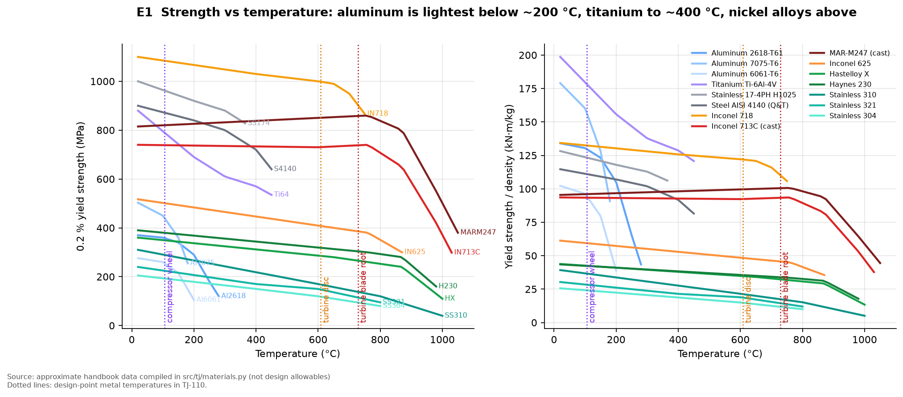
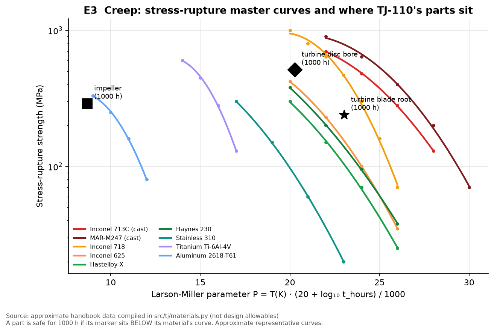
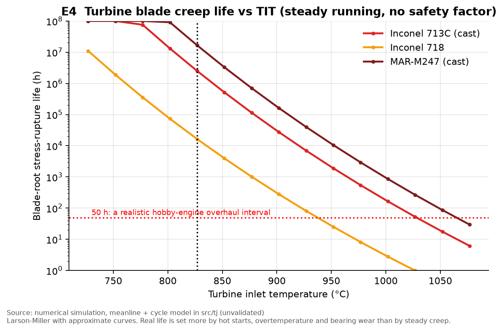
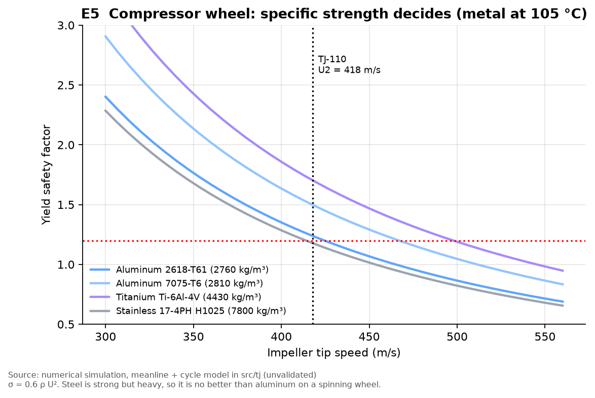
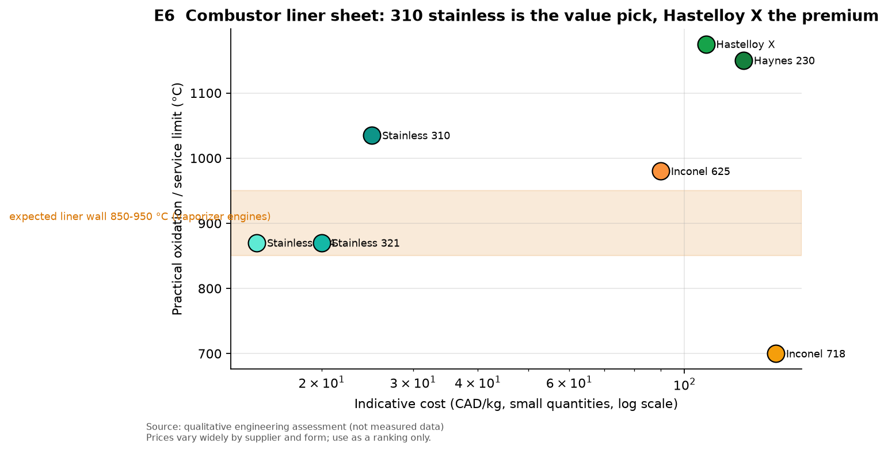
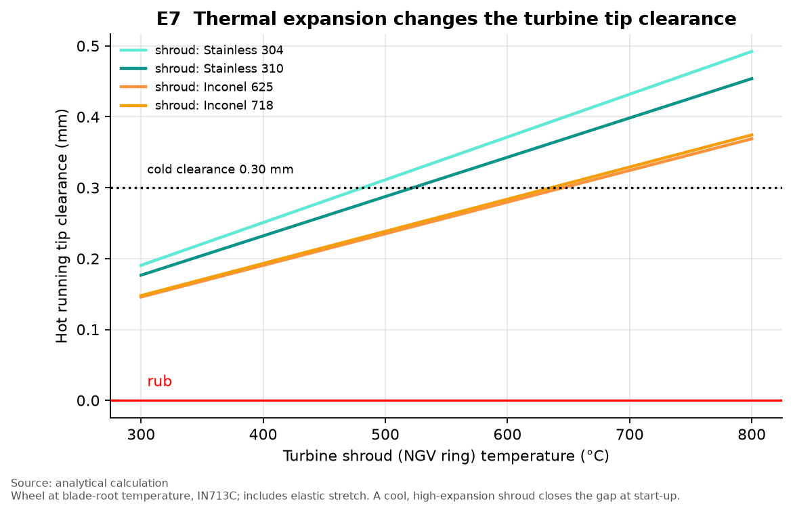
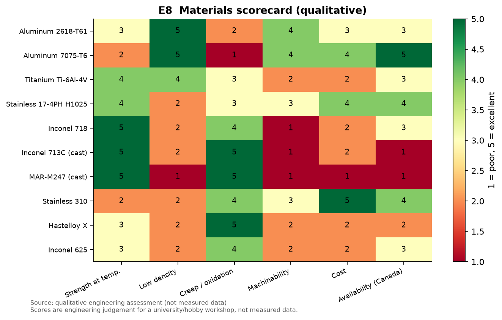

# Phase E: materials

Script: `simulations/phase_e_materials.py`. Data: `data/phase_e_*.csv`.

> **About the data.** Strength-vs-temperature tables and Larson–Miller creep curves in `src/tj/materials.py`
> are approximate representative values from handbook and supplier data-sheet trends. They are good for
> ranking materials and sizing a study. **They are not design allowables.** Get certified data for the exact
> alloy, temper and form before making a part that spins. No peer-reviewed IN713C creep dataset was located
> for the literature review; that curve in particular is a placeholder.

## 1. Strength vs temperature

What decides a spinning part is **strength per unit density** (its own mass makes the load):
- **Below ~150 °C** aluminum alloys win; 7075 is strongest but softens fast above 120 °C; **2618** keeps its
  strength to ~200 °C, which is why it is the standard turbocharger-wheel alloy.
- **150–400 °C**: Ti-6Al-4V is unbeatable but slow to machine and costly.
- **Above ~650 °C** only nickel superalloys work. IN718 is strongest to ~650 °C then drops steeply;
  cast **IN713C** and MAR-M247 hold strength to ~900 °C.

## 2. Creep

| TIT | Blade root metal | IN713C life (steady, model) |
|---|---|---|
| 1100 K (827 °C, design) | 728 °C | > 10⁶ h |
| 1200 K | 830 °C | ~7 000 h |
| 1250 K | 881 °C | ~540 h |
| 1300 K | 932 °C | ~50 h |

At the design TIT steady creep is not a concern. The turbine wheel's life is set by **hot starts and
overtemperature events** (EGT spikes of 900–1000 °C for seconds during a bad start), plus bearing wear.
The creep curve shows how fast margin disappears: every 50 K above ~1200 K TIT costs a factor of ~10 in life.
**IN718 is not suitable for the turbine wheel above ~1100 K TIT.**

## 3. Compressor wheel

| Material | Safety factor at 418 m/s, 105 °C | Mass (relative) | Verdict |
|---|---|---|---|
| Al 2618-T61 | 1.24 | 1.0 | **Chosen**: standard turbo alloy, machinable |
| Al 7075-T6 | ~1.6 cold, but loses strength above 120 °C | 1.0 | Risky near the hot diffuser |
| Ti-6Al-4V | 1.70 | 1.6 | Upgrade path for higher PR or speed |
| 17-4PH steel | ~1.1 | 2.8 | Strong but heavy: no better |

## 4. Hot sheet parts (liner, NGV, nozzle)

**310 stainless** is the best value for the combustor liner and vaporizer tubes (good to ~1035 °C,
cheap, weldable). **Hastelloy X** or Haynes 230 last longer if hot spots appear. 304/321 are fine for the
nozzle (≈ 715 °C) but not for the liner.

## 5. Thermal expansion and clearance

The turbine wheel grows about 0.28 mm on radius when hot (thermal + elastic). If the NGV/shroud ring is
still cool (start-up), the 0.30 mm cold clearance almost disappears: **a rub during start is likely with a
low-expansion shroud.** The shroud ring should be thin and in a high-expansion alloy (304/310) so it heats and
grows as fast as the wheel.

## 6. Scorecard and selection

| Part | Chosen | Alternative | Metal temp. | Why |
|---|---|---|---|---|
| Compressor wheel | Al 2618-T61 | Ti-6Al-4V | 105 °C | Specific strength at temperature, machinable |
| Diffuser | Al 6061-T6 | Al 2618 | ≈ 150 °C | Cheap, easy |
| Shaft | 17-4PH H1025 | 4140 Q&T | 250–350 °C | Strength, corrosion resistance, grinds well |
| Bearings | 608 hybrid (Si₃N₄ balls) | – | ≤ 150 °C | Steel 608s exceed their DN limit at 110 krpm |
| Combustor liner, vaporizers | 310 stainless | Hastelloy X | 850–1000 °C | Oxidation resistance per dollar |
| NGV ring | Inconel 625 | Inconel 718 | gas 827 °C | Weldable, oxidation resistant |
| Turbine wheel | IN713C cast | MAR-M247 | 728 °C root | Creep + castability; buy a cast blank |
| Nozzle, tail cone | 321 stainless | 310 | ≈ 715 °C | Cheap sheet |
| Outer casing | 304 stainless | – | 150–400 °C | 1 mm tube |
| Front cover, inlet | Al 6061-T6 | – | ≤ 60 °C | Machined |

Also in `data/phase_e_material_selection.csv`.
