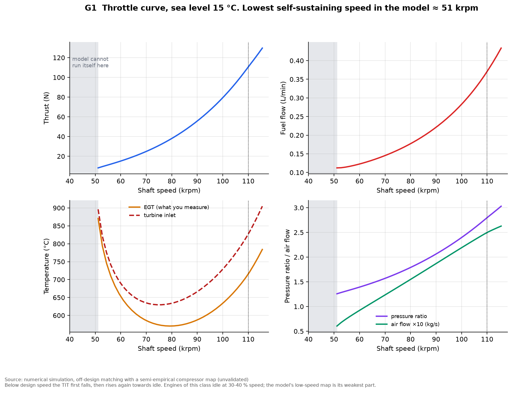
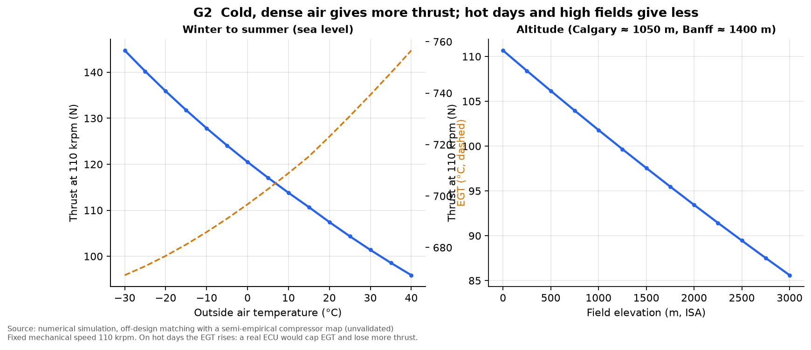
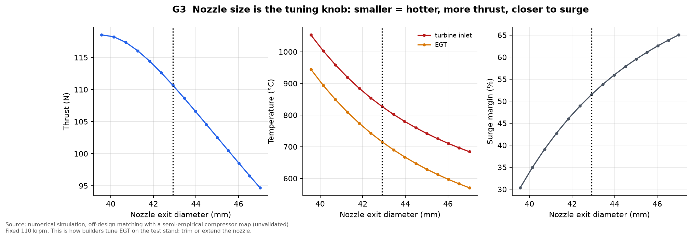

# Phase G: off-design (throttle, weather, altitude, nozzle)

Script: `simulations/phase_g_offdesign.py`. Data: `data/phase_g_*.csv`.
[off-design matching with a semi-empirical compressor map, unvalidated]

## 1. Throttle curve

| Speed (krpm) | Thrust (N) | Fuel (L/min) | EGT (°C) | TIT (°C) | PR |
|---|---|---|---|---|---|
| 51 | 8 | 0.11 | 871 | 896 | 1.26 |
| 61 | 16 | 0.12 | 642 | 679 | 1.41 |
| 71 | 26 | 0.15 | 583 | 633 | 1.59 |
| 81 | 39 | 0.18 | 571 | 635 | 1.81 |
| 91 | 57 | 0.23 | 590 | 670 | 2.09 |
| 101 | 81 | 0.29 | 638 | 734 | 2.42 |
| 110 | 111 | 0.37 | 715 | 827 | 2.80 |

- Thrust rises roughly as speed cubed: **half speed gives under 10 % thrust.**
- **EGT is U-shaped.** It is lowest near 75–80 krpm and rises steeply towards idle, where the components are
  inefficient. This is the well-known behaviour that makes starts and idle the hot, dangerous phases.
- In the model the engine cannot sustain itself below **~51 krpm (46 %)**. Real engines of this class
  idle at 30–40 % speed. Our assumed low-speed map is pessimistic; **find the real idle on the test stand**.

## 2. Weather and altitude (at 110 krpm)

| Condition | Thrust | EGT |
|---|---|---|
| −30 °C winter day | 145 N (+31 %) | 669 °C |
| 15 °C standard | 111 N | 715 °C |
| +35 °C summer day | 99 N (−11 %) | 748 °C |
| Calgary (1 050 m, ISA) | 101 N (−8 %) | 706 °C |

Cold air is denser and the compressor works at a higher *corrected* speed, so a fixed-speed engine pushes
more air. **On a cold day the engine makes much more thrust and the test stand and mounts must take it.**
On hot days EGT climbs; an ECU with an EGT limit will cut back speed.

## 3. Nozzle exit area: the tuning knob

| Nozzle Ø | Thrust | EGT | Surge margin |
|---|---|---|---|
| 40.7 mm | 117 N | 850 °C | 39 % |
| **42.9 mm** | **111 N** | **715 °C** | **52 %** |
| 45.0 mm | 103 N | 629 °C | 60 % |

A 5 % smaller nozzle (≈ 2 mm in diameter) adds ~6 N but raises EGT by 135 °C. Builders tune EGT on the stand by
**trimming the nozzle in small steps**. Start larger (≈ 44 mm) and close it down while watching EGT.
