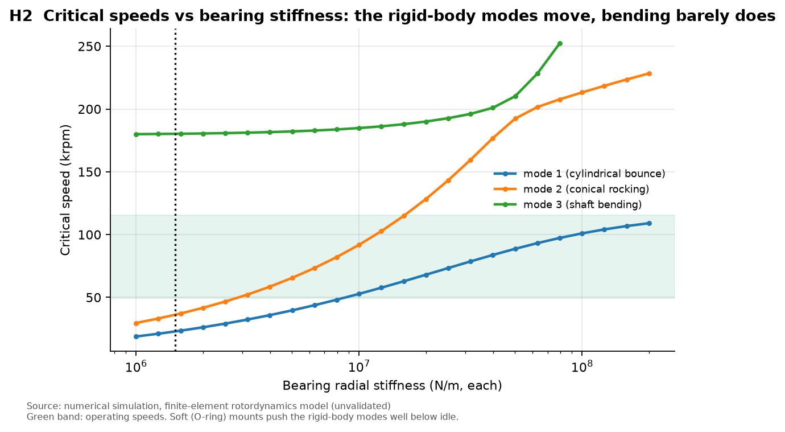
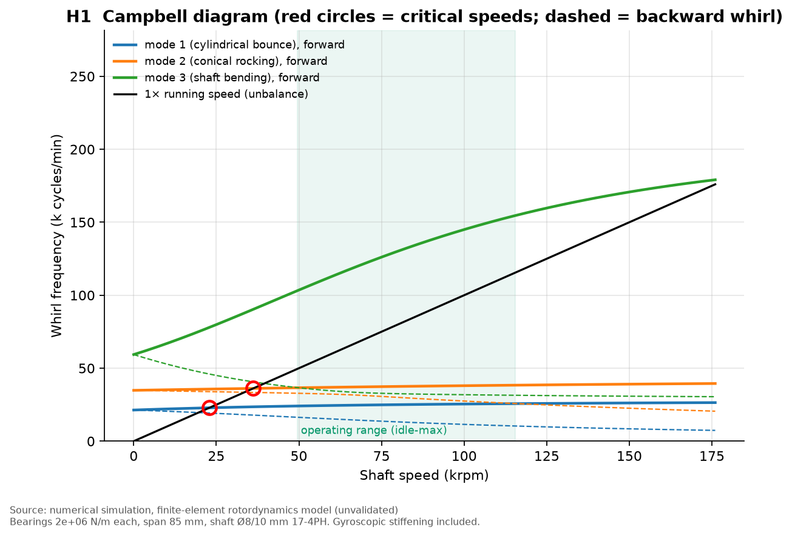
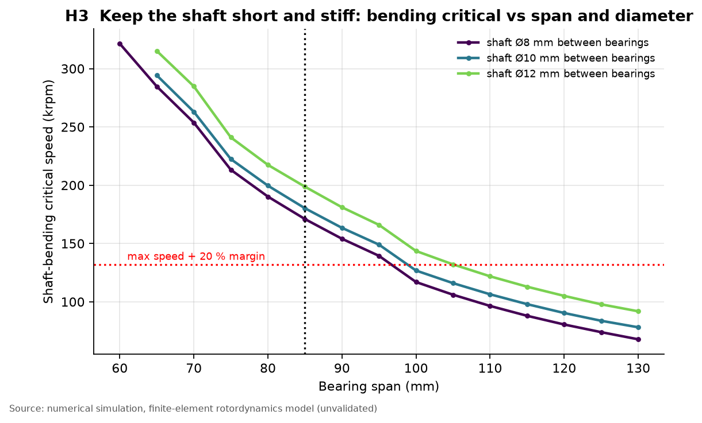
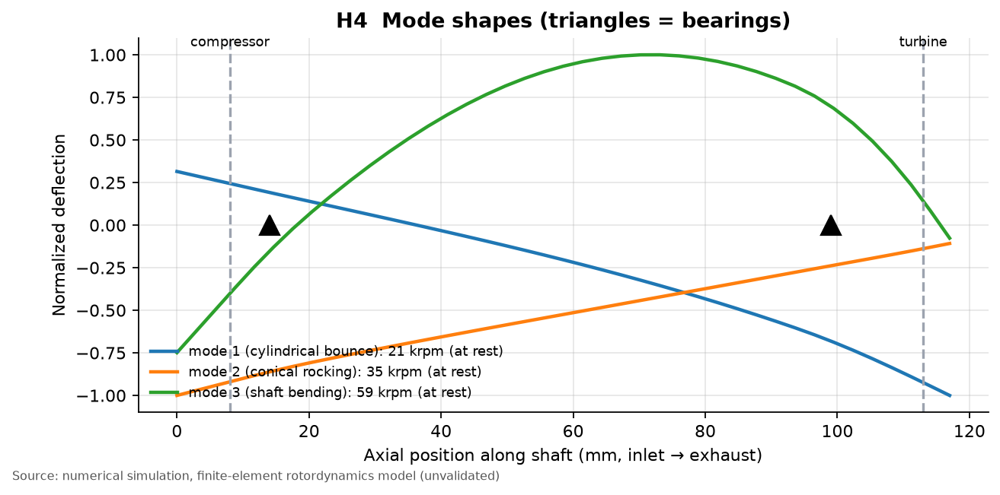
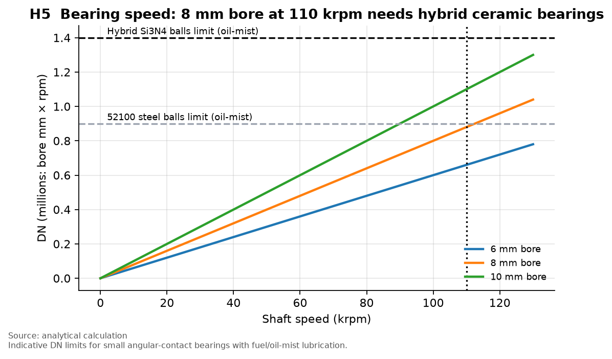

# Phase H: rotordynamics and bearings

Script: `simulations/phase_h_rotordynamics.py`. Data: `data/phase_h_*.csv`. [finite-element rotordynamics model, unvalidated]

## 1. The rotor

| Item | Value |
|---|---|
| Shaft | 17-4PH, Ø8 mm at the bearings, Ø10 mm between, 117 mm long |
| Bearings | Two 608-size hybrid ceramic (8 × 22 × 7 mm), 85 mm apart |
| Compressor wheel | ≈ 75 g, overhung ahead of the front bearing |
| Turbine wheel | ≈ 163 g, overhung behind the rear bearing |
| Bearing support | **Outer races in O-ring dampers, ≈ 1.5 × 10⁶ N/m each** |

## 2. The key finding: soft-mount the bearings

A rotor on two bearings has two **rigid-body modes** (the whole rotor bouncing, and rocking) and a **bending mode**.

| Bearing support | Bounce | Rocking | Bending |
|---|---|---|---|
| Hard-mounted (≈ 10⁷ N/m) | 53 krpm | 92 krpm | 185 krpm |
| **O-ring mounted (1.5 × 10⁶ N/m)** | **23 krpm** | **36 krpm** | **180 krpm** |

With hard-mounted bearings **both rigid-body critical speeds fall inside the operating range (51–110 krpm)**:
the engine would sit on a resonance at part throttle. Mounting the bearing outer races in elastomer O-rings
moves both below idle. The rotor passes through them during start-up (when the starter is spinning it and
forces are small), and the O-rings add damping. This is the same reason commercial turbochargers float their
bearings. The bending mode is barely affected and stays 64 % above maximum speed.

## 3. Campbell diagram

Gyroscopic stiffening from the wheels raises the forward-whirl frequencies with speed. The rocking mode's
forward branch crosses the running-speed line only at 36 krpm.

## 4. Span and shaft diameter

The bending critical speed falls fast with bearing span: 85 mm → 180 krpm; 110 mm → 106 krpm (below max
speed!). **Keep the bearing span ≤ 95 mm and the shaft ≥ 10 mm between bearings.** The combustor length is
what sets the span; that is the main reason not to make the liner longer.

## 5. Bearing speed limit

DN = 8 mm × 110 000 rpm = 0.88 × 10⁶. Steel-ball bearings are limited to about 0.9 × 10⁶ even with good
lubrication, which leaves no margin; **hybrid ceramic (Si₃N₄ ball) bearings** (≈ 1.4 × 10⁶) are required.
They are lubricated by a small fuel/oil mist bled to the bearings, and must stay below ~150 °C.

## 6. Not modelled

Unbalance response amplitudes, O-ring damping values, bearing nonlinearity, and thermal bow. **Balance both
wheels and the assembled rotor** (accept ≤ 0.5 g·mm per plane, aim for ≤ 0.1 g·mm; see the [build package](../../prototypes/README.md)).
