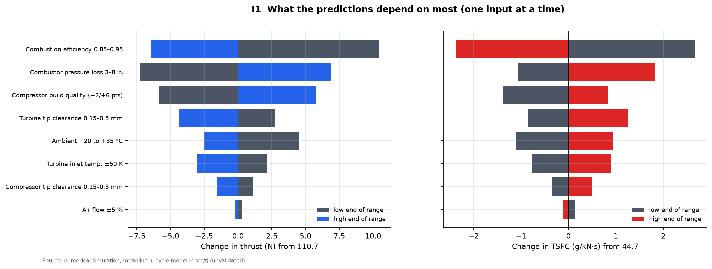
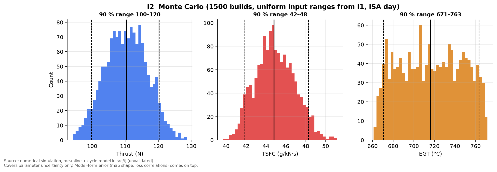
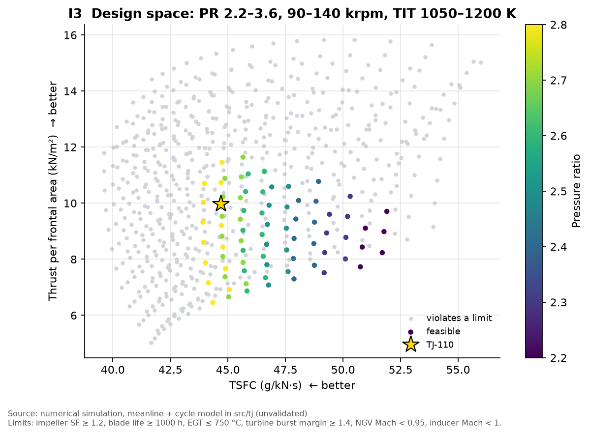

# Phase I: sensitivity, uncertainty and design-space search

Script: `simulations/phase_i_sensitivity.py`. Data: `data/phase_i_*.csv`. [numerical simulation, unvalidated]

## 1. What the predictions depend on most

| Input (range) | Thrust change | TSFC change |
|---|---|---|
| Ambient −20 to +35 °C | +10.5 / −6.5 N | −1.1 / +0.9 |
| Turbine inlet temperature ±50 K | −7.3 / +6.9 N | −0.8 / +0.9 |
| Air flow ±5 % | −5.8 / +5.8 N | small |
| Compressor build quality (−2 to −6 pts) | +4.5 / −2.5 N | −1.4 / +0.8 |
| Combustor pressure loss 3–8 % | +2.7 / −4.4 N | −1.1 / +1.8 |
| Turbine tip clearance 0.15–0.5 mm | +2.2 / −3.0 N | −0.9 / +1.3 |
| Compressor tip clearance 0.15–0.5 mm | +1.1 / −1.5 N | −0.4 / +0.5 |
| Combustion efficiency 0.85–0.95 | ≈ 0 | +2.7 / −2.4 |

Outside conditions and turbine temperature aside, **what the builder controls most is compressor quality,
combustor pressure loss and turbine clearance.**

## 2. Monte Carlo

1 500 builds with every builder-controlled input drawn from the ranges above (ISA day):

| | 5 % | median | 95 % |
|---|---|---|---|
| Thrust | 100 N | 110 N | 121 N |
| TSFC | 41.8 | 44.8 | 48.3 g/kN·s |
| EGT | 671 °C | 716 °C | 763 °C |

This covers parameter uncertainty only. Model-form error (loss correlations, map shape) comes on top;
the benchmark against a published engine suggests about ±10 %.

## 3. Is TJ-110 a good design point?

660 designs (PR 2.2–3.6, 90–140 krpm, TIT 1050–1200 K) were checked against six limits: impeller SF ≥ 1.2,
blade creep life ≥ 1 000 h, EGT ≤ 750 °C, turbine burst margin ≥ 1.4, NGV Mach < 0.95 and inducer Mach < 1.
Only 12 % pass. The highest-thrust feasible designs are all **PR 2.8 at TIT 1100 K**; speed only trades
diameter (105 krpm → 124 mm, 115 krpm → 115 mm). **TJ-110 sits at the best feasible point.** Going further needs
a titanium impeller (higher PR) or higher-temperature EGT limits.
