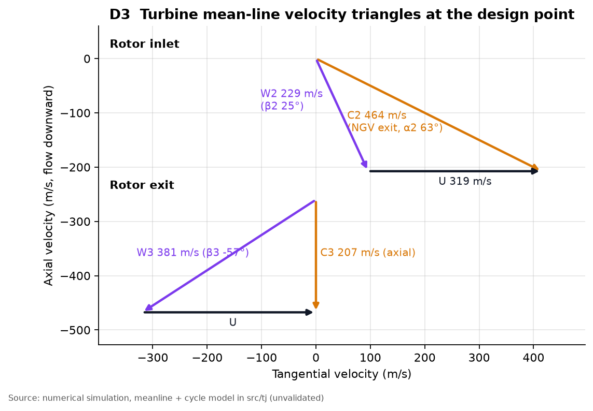
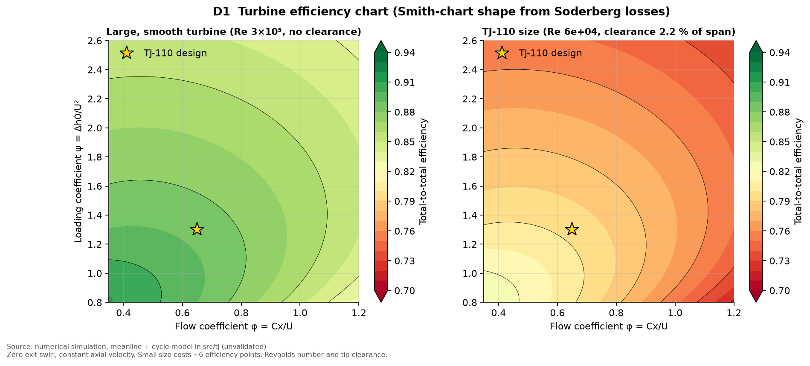
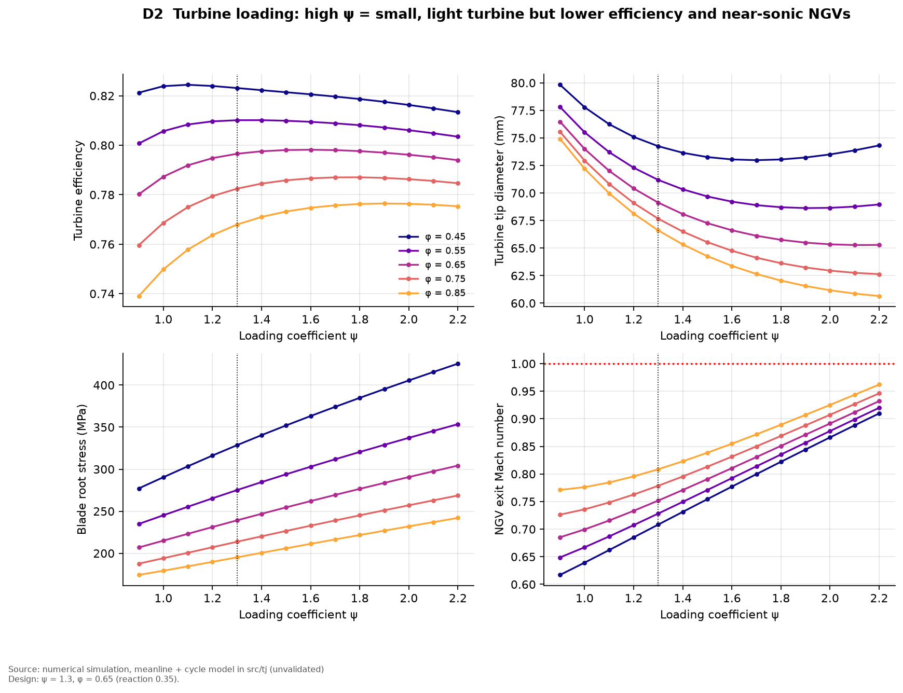
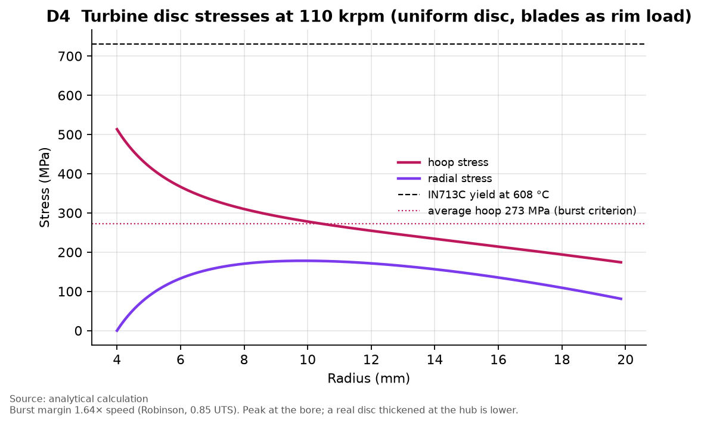
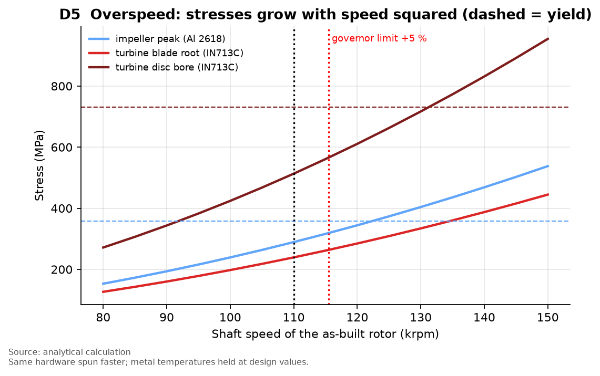

# Phase D: turbine

Script: `simulations/phase_d_turbine.py`. Data: `data/phase_d_*.csv`. [numerical simulation / analytical calculation, unvalidated]

## 1. The TJ-110 turbine

| Quantity | Value |
|---|---|
| Tip / mean / hub diameter | 69.1 / 55.4 / 41.7 mm |
| Blade height, axial chord | 13.7 mm, 13.7 mm |
| Blades / NGVs | 27 / 19 |
| Loading ψ, flow coefficient φ, reaction | 1.3, 0.65, 0.35 |
| NGV exit angle α2 / Mach number | 63° / 0.75 |
| Rotor inlet / exit relative angles | 25° / −57° |
| Mean blade speed | 319 m/s (tip 398 m/s) |
| Efficiency (total-to-total) | 0.797 |
| Pressure ratio | 1.76 |
| Relative total temperature seen by the blades | 758 °C |

## 2. Choosing the loading

For a large turbine, Soderberg's losses predict ~89 % at this (φ, ψ). At TJ-110's size the Reynolds number
is only 6×10⁴ and the tip clearance is 2.2 % of the span, which together cost ~9 points. The Soderberg-only
chart puts the optimum at lower φ and ψ than Smith's measured chart (φ ≈ 0.5–0.9, ψ ≈ 1–2.5) because it
ignores secondary-flow and trailing-edge losses; the design point is in the region both agree on.

| ψ | Efficiency | Tip Ø (mm) | Blade height (mm) | Root stress (MPa) | NGV Mach |
|---|---|---|---|---|---|
| 0.9 | 0.780 | 76.5 | 9.9 | 207 | 0.69 |
| **1.3** | **0.797** | **69.1** | **13.7** | **239** | **0.75** |
| 1.8 | 0.798 | 65.8 | 18.7 | 277 | 0.85 |
| 2.2 | 0.794 | 65.3 | 22.7 | 304 | 0.93 |

Efficiency is flat between ψ ≈ 1.3 and 1.9. **ψ = 1.3** was chosen because the turbine tip then matches the
compressor size (69 vs 73 mm, so one casing diameter works), the blades stay short and stiff (hub/tip 0.60), and
the NGVs stay well below sonic.

## 3. Stresses and burst margin

| Item | Stress | Metal temperature | Margin |
|---|---|---|---|
| Blade root (IN713C) | 239 MPa | 728 °C | yield SF 3.1; creep: see [materials](materials.md) |
| Disc bore (uniform disc) | 513 MPa | ~610 °C | yield SF 1.4 |
| Disc average hoop stress | 273 MPa | ~610 °C | **burst at 1.64× design speed** |

The uniform-disc model is conservative: a real disc is thicker at the hub, which lowers the bore stress.

Stress grows with the square of speed. At about **+11 % overspeed (122 krpm)** the impeller, the weakest
part, reaches its yield strength (SF 1.24 → √1.24 = 1.11). **The ECU must limit speed to 110 krpm (+3 % governor
tolerance)**, and the engine must never run without a working speed sensor.
