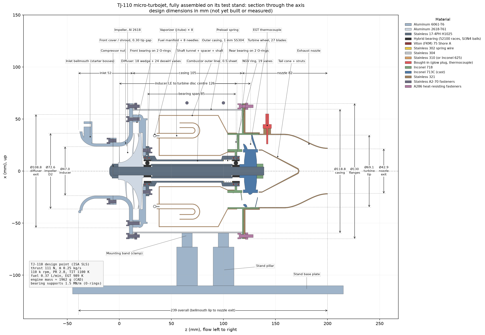
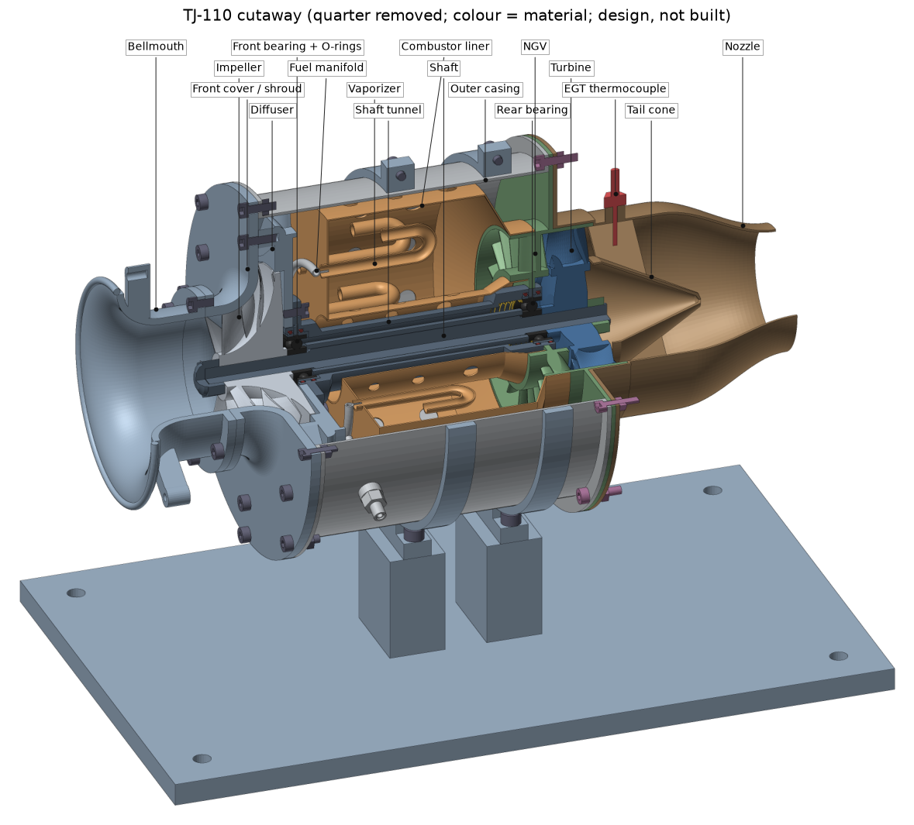
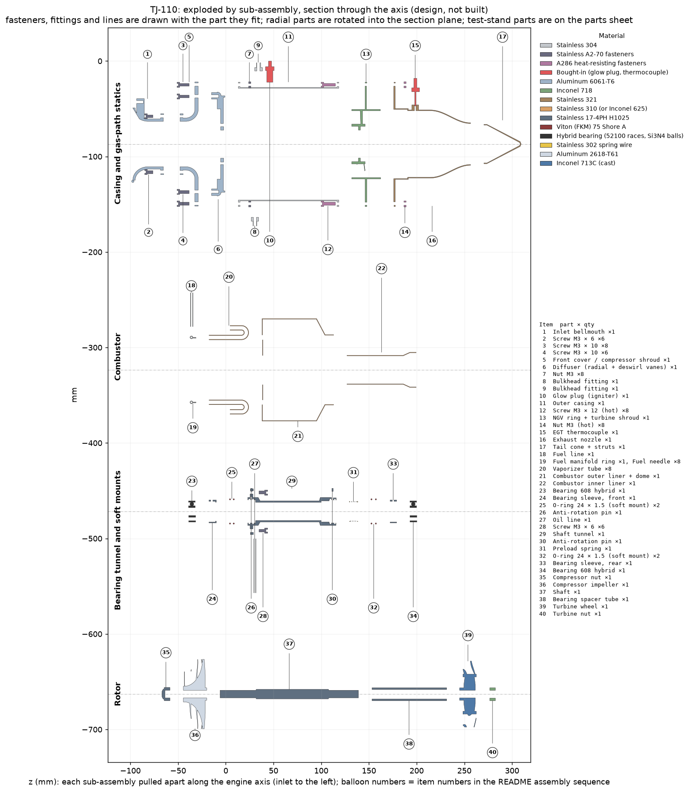
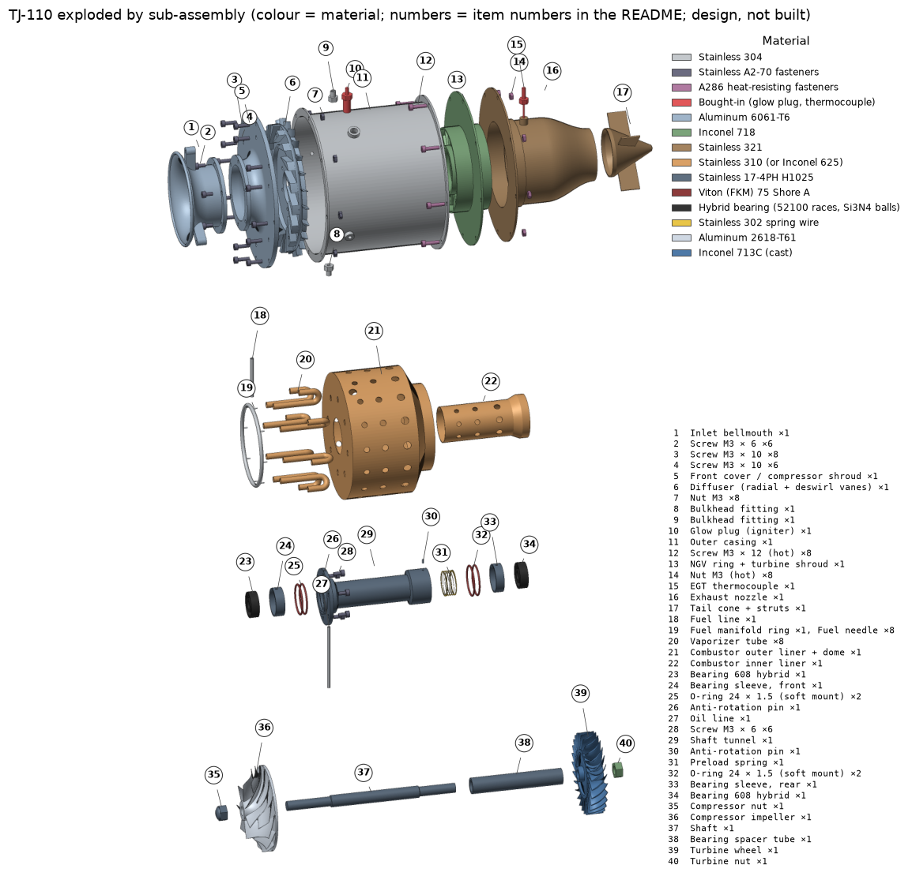
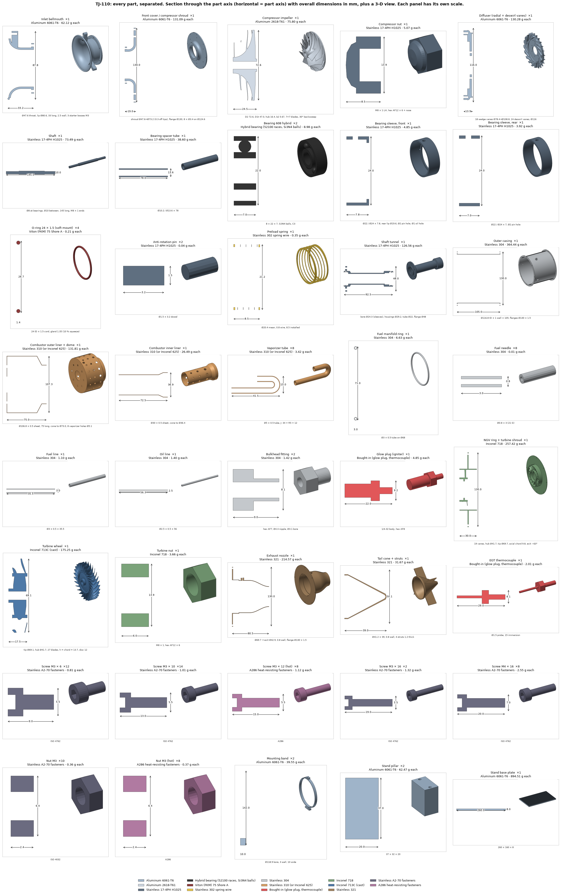

# TJ-110 build package

**Status: designed, not yet built or run.** Every dimension here is a **design dimension** from the
parametric CAD model ([`../cad/build.py`](../cad/build.py)), in millimetres. The CAD model takes its
gas-path sizes from [`data/design_point.json`](../data/design_point.json). The as-built and first-run
tables at the end are blank, ready to fill in.

Regenerate this folder with `.venv/bin/python cad/build.py` and then
`.venv/bin/python prototypes/build_drawings.py` (about 45 s + 2 min).

> A gas turbine at 110 000 rpm stores enough energy in its rotor to go through thin sheet metal if a
> wheel bursts. Run it only on the restrained test stand behind a containment shield, with nobody in
> the plane of the wheels, a CO2 extinguisher at hand, and a fuel shut-off within reach.

## Fully assembled

| Key dimension | Value (mm) |
|---|---|
| Overall length, bellmouth lip to nozzle exit (no starter) | 239 |
| Casing ID × wall / flange OD | Ø116.8 × 1.0 / Ø130 |
| Impeller tip D2 / inducer tip / hub | Ø72.6 / Ø47.0 / Ø16.4 |
| Impeller exit blade height b2 / tip clearance | 5.67 / 0.30 |
| Diffuser vanes: wedge LE → exit Ø | Ø78.4 → Ø108.8 |
| Bearing span (608 hybrid centres) | 85 |
| Combustor liner Ø (inner / outer) × length | Ø30 / Ø106.8 × 75 |
| NGV and turbine hub / tip Ø | Ø41.7 / Ø69.1 (shroud Ø69.7) |
| Turbine blade height = axial chord | 13.7 |
| NGV trailing edge to rotor leading edge | 1.0 |
| Nozzle exit Ø | Ø42.9 |

Design point (model, ISA sea-level static): thrust 111 N at 110 000 rpm, 0.25 kg/s, pressure ratio 2.8,
TIT 1100 K, EGT 989 K, fuel 0.37 L/min Jet A-1.

## Separated parts

3-D versions: [`TJ110_viewer_exploded.html`](TJ110_viewer_exploded.html) (interactive; open in a browser)
and `TJ110_exploded.stl`. Individual part STLs are in [`../cad/stl/`](../cad/stl/). The balloon numbers
in the exploded views (1–40) are the item numbers used in the assembly sequence below.

## Parts, materials and manufacturing route

| Item | Part | Qty | Material | Mass each (g) | Manufacturing route |
|---|---|---|---|---|---|
| 36 | Compressor impeller | 1 | **Al 2618-T61** | 75.8 | 5-axis milled from forged bar (a job shop with impeller CAM). Bore and back face finished in one set-up, then balanced. 2618 keeps its strength at the 105 °C wheel temperature better than 6061 or 7075. |
| 39 | Turbine wheel | 1 | **Inconel 713C** | 175 | **Investment-cast blank** (printed wax pattern, vacuum-cast by a foundry), then finish-turned: bore, faces, tip Ø69.10 h7. X-ray the blank for porosity. IN713C is the standard cast alloy for small turbine wheels (blade root ~730 °C). |
| 13 | NGV ring + turbine shroud | 1 | **Inconel 718** | 257 | Rings turned; 19 vanes wire-EDM'd from plate and vacuum-brazed into slots. Alternatively cast in IN713C with the turbine. The shroud is ground to Ø69.72 after brazing. |
| 6 | Diffuser | 1 | **Al 6061-T6** | 130 | CNC lathe, then 4-axis milling of the 18 wedge vanes and 24 deswirl vanes. One piece. |
| 5, 1 | Front cover, bellmouth | 1 + 1 | **Al 6061-T6** | 131, 62 | CNC lathe. The shroud contour is turned from the CAD offset curve; the bellmouth bosses are milled. |
| 37, 38, 35 | Shaft, spacer tube, compressor nut | 1 + 1 + 1 | **17-4PH**, aged H1025 | 73.5, 38.6, 5.1 | Turned, aged, then bearing seats and spacer faces ground. Runout ≤ 0.005 TIR. |
| 40 | Turbine nut | 1 | **Inconel 718** | 3.7 | Turned + hex. It sits at about 600 °C, too hot for 17-4PH. |
| 29, 24, 33, 26/30 | Shaft tunnel, bearing sleeves, anti-rotation pins | 1 + 2 + 2 | **17-4PH** | 127, 4.9, 3.9 | Turned and ground; 4 O-ring grooves in the tunnel bore; Ø1.5 dowels. |
| 23/34 | Bearing 608 hybrid | 2 | 52100 + Si3N4 | 9.0 | **Buy**: 8 × 22 × 7, ceramic balls, C3, high-speed cage. DN = 0.88 × 10⁶, inside the 1.4 × 10⁶ hybrid limit. |
| 25/32 | O-ring 24 × 1.5 | 4 | **Viton FKM 75** | 0.2 | **Buy**. Soft bearing mount; Viton is rated for oil and kerosene to ~200 °C. |
| 31 | Preload spring | 1 | 302 spring wire | 0.4 | **Buy** a stock spring or have one wound: Ø20.4 mean, 0.8 wire, 20–30 N at 8.5 mm. |
| 11 | Outer casing | 1 | **SS304**, 1 mm sheet | 364 | Rolled and TIG seam-welded; flanges and 3 bosses TIG-welded, then both flanges faced square. |
| 21, 22 | Combustor outer liner + dome, inner liner | 1 + 1 | **SS310**, 0.5 mm (Inconel 625 for longer life) | 132, 26.5 | Holes laser-cut in the flat patterns, then rolled and TIG-welded (sheet/TIG route). The dome is welded to the outer liner. |
| 20 | Vaporizer tube | 8 | SS310 Ø5 × 0.5 tube | 3.4 | Bent over an R5 former; TIG-welded into the dome. |
| 19, 18, 27, 8/9 | Fuel manifold + 8 needles, fuel line, oil line, bulkhead fittings | 1 set | SS304 | — | Ø3 tube ring, 21 G hypodermic needles silver-brazed in; turned fittings. |
| 16, 17 | Nozzle, tail cone + struts | 1 + 1 | **SS321**, 0.8 mm | 215, 31.7 | Spun or rolled sheet; 1.5 mm flange welded on; the tail-cone struts are welded to the nozzle wall. |
| 10, 15 | Glow plug, EGT thermocouple | 1 + 1 | bought-in | — | **Buy**: model-engine glow plug (1/4-32); K-type Ø1.5 probe with a compression fitting. |
| 2, 28, 3, 4, 7 | M3 screws and nuts (cold) | 12 + 14 + 10 | A2-70 | — | **Buy**: ISO 4762 / ISO 4032 |
| 12, 14 | M3 × 12 screws and nuts, rear flange | 8 + 8 | **A286** | — | **Buy**: heat-resisting, because the rear flange runs at about 500–600 °C |
| — | Mounting bands, pillars, base plate, M3 × 16, M4 × 16 | 2, 2, 1, 2, 8 | Al 6061 / A2 | — | Test stand only. Waterjet or saw and drill. |

**Engine mass about 1.96 kg** (CAD, without the stand; the stand is 1.12 kg more). The rotor is 372 g
without the bearings. Full list with dimensions: [`TJ110_parts_list.csv`](TJ110_parts_list.csv);
bill of materials: [`../cad/bom_TJ110.csv`](../cad/bom_TJ110.csv).

**Also needed (not modelled):** starter motor with a one-way clutch cone and a bracket for the three
bellmouth bosses, fuel pump, solenoid valves, ECU, propane start kit, rpm sensor, high-temperature
anti-seize for the hot fasteners, turbine oil, and silicone or PTFE fuel and oil hose outside the casing.

## Tolerances and fits

| Feature | Design | Fit / tolerance | Why |
|---|---|---|---|
| Shaft at bearings | Ø8.000 | js5 (±0.003) | Light push fit of the inner races. The nuts clamp the stack. |
| Impeller and turbine bores | Ø8.000 (CAD 8.010) | H6 | Slide fit on the shaft. The clamped stack carries the torque. |
| Bearing sleeve bore (outer race) | Ø22.000 | H6, 0.002–0.010 clearance | The rear outer race must slide so the spring preload works |
| Bearing sleeve OD | Ø24.000 | h6 | |
| Tunnel bore over the sleeves | Ø24.30 | H7 | 0.15 mm radial travel on the O-rings (snubber gap) |
| O-ring groove in the tunnel bore | Ø26.70 × 1.9 wide | +0.05 / +0.1 | 1.35 mm gland for a 1.5 mm cord: 10 % squeeze, no stretch on the 24 mm ID |
| Impeller tip clearance | 0.30 | ±0.05 (set by shims between front cover and diffuser) | Every 0.1 mm costs about 0.6 points of compressor efficiency (model) |
| Turbine tip: shroud Ø69.72 / blade tip Ø69.10 | 0.30 radial | shroud H7, tip h7 | Ground after brazing / finish-turning |
| Rotor runout at the wheels | — | ≤ 0.02 TIR | |
| Flanges | faced flat | ≤ 0.05 flatness | Gas seal without a gasket |

## Balancing

Both wheels run supercritical on soft mounts: the rigid-body modes are at about 22 900 and 36 200 rpm,
below idle. Residual unbalance therefore matters most for bearing load and vibration at speed.
Acceptance limit: **≤ 0.5 g·mm per plane**. On a 372 g rotor that is about ISO G31. Aim lower,
≤ 0.1 g·mm per plane (about G6.3), if the machine can resolve it.
1. **Wheels individually.** Mount each wheel on a precision arbour (Ø8 h3, runout ≤ 0.002) and balance
   in two planes. Impeller: remove material from the back-face rim and the nose of the hub, never from
   the blades. Turbine: remove material from the disc faces just inside the blade roots (r ≈ 18–19), never
   from the blades or the bore.
2. **Assembled rotor.** Assemble shaft, spacer, bearings, impeller, turbine and both nuts at the working
   clamp torque. Balance in the impeller plane and the turbine plane with the bearings supported in a
   V-block or soft fixture. Correct with small amounts only; above about 0.2 g·mm, go back to step 1.
3. **Mark the angular position** of each wheel and nut on the shaft (scribe line). Reassemble in exactly
   that orientation after the rotor goes into the tunnel.
4. Re-check after the first run and after any bearing change.

## Assembly sequence (balloon numbers from the exploded views)
The bores of the fuel manifold, the liners and the NGV hub are all smaller than the Ø69 turbine, so they
go on over the tunnel **before** the turbine wheel. The casing goes on before the NGV, because the NGV
flange is as large as the casing flange.

1. **Tunnel.** Press the anti-rotation pins **26** and **30** into the shaft tunnel **29**. Lightly oil the
   four O-rings **25** and **32** and roll them into their grooves.
2. **Diffuser to tunnel.** Bolt the diffuser **6** to the tunnel front flange with 6 × M3 × 6 **28** from
   the rear (thread-locker).
3. **Rear sleeve.** From the rear, drop in the preload spring **31**, then the rear sleeve **33** (slot over pin **30**).
4. **Shaft.** Slide the spacer tube **38** onto the shaft **37** and insert the shaft into the tunnel from the front.
5. **Bearings.** Press the front bearing **23** into the front sleeve **24** against its lip. Slide the pair
   over the front of the shaft into the front housing (slot over pin **26**). From the rear, slide the
   rear bearing **34** onto the shaft and into the rear sleeve.
6. **Impeller.** Fit the impeller **36** and the compressor nut **35** in the balanced orientation, finger-tight.
7. **Fuel manifold.** From the rear, slide the fuel manifold with its 8 needles **19** over the tunnel until
   it sits just behind the diffuser.
8. **Combustor.** Slide the combustor on from the rear: outer liner + dome **21** with the 8 vaporizers
   **20** welded in, and the inner liner **22** inside it. Each needle should enter its vaporizer by about 2.5 mm.
9. **Front cover.** Offer the front cover **5** over the impeller and fasten it to the diffuser vanes with
   6 × M3 × 10 **4**. Measure the impeller tip clearance with feeler gauges at 4 positions and shim to
   0.30 ± 0.05.
10. **Casing.** Slide the outer casing **11** on from the rear and bolt its front flange to the front cover
    (8 × M3 × 10 **3**, nuts **7**).
11. **NGV.** Fit the NGV ring **13** from the rear. Its hub web slides over the tunnel spigot, which
    leaves the tunnel free to grow axially. Both liner lips slide onto the NGV spigots, and the NGV
    flange seats on the casing flange.
12. **Turbine.** Fit the turbine wheel **39** and nut **40** in the balanced orientation. Hold the shaft and
    torque both nuts to clamp the stack. Check free spin, zero axial end float (it is spring-preloaded),
    runout ≤ 0.02, and the turbine tip clearance at 4 positions.
13. **Lines and igniter.** Push the fuel line **18** in through its boss into the manifold socket, and the
    oil line **27** into the drilling in the front bearing housing (push-in O-ring sockets, not modelled).
    Then fit the bulkhead fittings **9** and **8**. Screw in the glow plug **10** so its tip stands 2.5 mm into
    the liner.
14. **Hot end.** Bolt the nozzle **16** (tail cone **17** welded in) to the NGV and casing flanges with
    8 × A286 M3 × 12 **12** and nuts **14** (high-temperature anti-seize). Fit the EGT thermocouple **15**
    (tip 15 mm into the gas path).
15. **Inlet.** Fit the bellmouth **1** with 6 × M3 × 6 **2**.
16. **Stand.** Clamp the two mounting bands on the casing and bolt them to the stand. Fit the starter
    bracket on the three bellmouth bosses.

## Cost estimate (CAD)

Indicative 2026 prices in Canadian dollars: rough ranges for one prototype, not quotes. The machining
prices assume outsourcing to Canadian job shops and a foundry. Itemized list:
[`TJ110_cost_estimate.csv`](TJ110_cost_estimate.csv).

| Category | Indicative cost | Biggest items |
|---|---|---|
| **Engine parts** (everything in the CAD, balancing, contingency) | **$3 235–11 410** | Turbine wheel casting $600–2 500, NGV $500–1 800, impeller $400–1 500 |
| ECU and instrumentation | $1 200–4 460 | ECU, fuel pump, load cell, DAQ |
| Test stand and safety | $600–2 010 | Containment shield, thrust sled |
| **Total** | **$5 035–17 880** | |

## As-built dimensional check (fill in after building)

| Check | Design (mm) | Tolerance | As built |
|---|---|---|---|
| Impeller tip clearance (4 positions) | 0.30 | ±0.05 | |
| Turbine tip clearance (4 positions) | 0.30 | ±0.05 | |
| NGV trailing edge to rotor leading edge | 1.0 | ±0.2 | |
| Shaft runout at the wheels | 0 | ≤ 0.02 TIR | |
| Residual unbalance, impeller / turbine plane | — | ≤ 0.5 g·mm | |
| Sleeve radial stiffness (static push test) | 1.5 MN/m | ±30 % | |
| Rotor coast-down from a hand spin (s) | — | n/a | |
| Engine mass | ≈ 1 960 g | n/a | |

## First-run results sheet (empty until run)

Date: ______  Ambient T: ______ °C  Ambient p: ______ kPa  Fuel: ______  Oil: ______ %

| Step | rpm | Thrust (N) | EGT (°C) | Fuel flow (L/min) | Compressor delivery p (kPa abs) | Oil p (kPa) | Vibration (mm/s) | Notes |
|---|---|---|---|---|---|---|---|---|
| Starter only (no fuel) | | | | | | | | |
| Propane light-off | | | | | | | | |
| Kerosene changeover | | | | | | | | |
| Idle (target ≥ 40 000) | | | | | | | | |
| 60 000 rpm | | | | | | | | |
| 80 000 rpm | | | | | | | | |
| 100 000 rpm | | | | | | | | |
| 110 000 rpm (design) | | | | | | | | |
| Shut-down / coast-down time | | | | | | | | |

| Quantity at 110 000 rpm | Model prediction | Measured |
|---|---|---|
| Thrust | 111 N | |
| Fuel flow | 0.37 L/min (4.9 g/s) | |
| EGT | 989 K (716 °C) | |
| Compressor delivery pressure | 281 kPa abs | |
| Specific fuel consumption | 44.7 g/(kN·s) | |
| Rigid-body criticals crossed during start | ~22 900 and ~36 200 rpm | |

Post-run inspection: bearing condition, O-ring condition, liner hot spots / cracking, turbine blade tips
(rub marks), NGV trailing edges, impeller tip rub. ______________________
